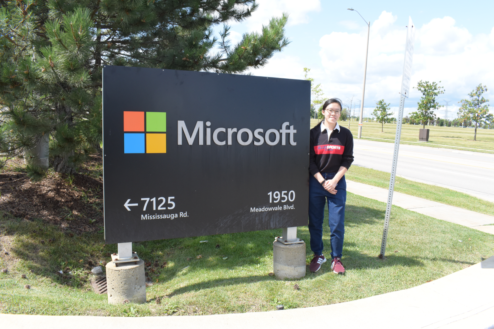
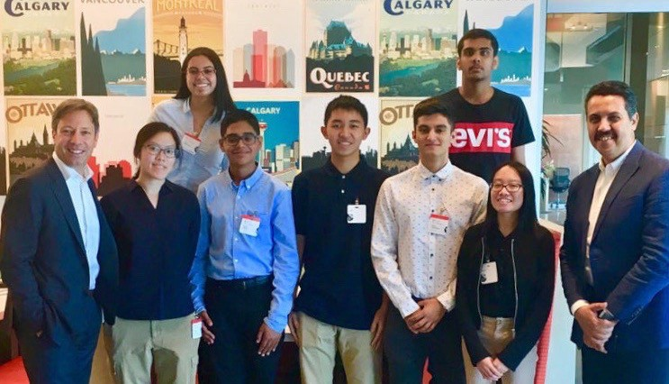

import { Link, graphql } from "gatsby"
import { AnchorLink } from "gatsby-plugin-anchor-links"
import { DetailsBlog, Blockquote } from "../../components/details.js"
import { NextPrevPosts } from "../../components/blogPost.js"

  <h1>{props.pageContext.frontmatter.title}</h1>

<DetailsBlog
  date={props.pageContext.frontmatter.date}
  time={props.pageContext.frontmatter.readTime}
/>

This past summer, I had the amazing opportunity to intern at Microsoft! During my time there, I had the opportunity to work with some incredible people, learn all about the inner-workings of the company, and even develop an app that is used internally within the company. Reflecting back, I learned three main things during my time there.

 

## 1. People make the place amazing

Microsoft is a really cool place to work. As such as large company, of course one would think that it is a great place. But nowadays, people boast the ping pong and foosball tables as all that is needed to make a company’s work culture “great” — instead, it’s the people around you that help to cultivate a really amazing working environment.

I remember coming to the office on my first day and one of the most memorable things was my managers, Lia De Cicco-Remu and Ahmed Adel, telling us to read Satya Nadella’s autobiography, **Hit Refresh** (<a href="https://www.amazon.ca/Hit-Refresh-Rediscover-Microsofts-Everyone/dp/0062652508/ref=tmm_hrd_swatch_0?_encoding=UTF8&qid=1580075928&sr=8-1" className="link" target="_blank" rel="noreferrer">Amazon</a> | <a href="https://www.chapters.indigo.ca/en-ca/books/hit-refresh-the-quest-to/9780062959720-item.html?ikwid=hit+refresh&ikwsec=Home&ikwidx=0" className="link" target="_blank" rel="noreferrer">Indigo</a>). They mentioned that it was a foundational part of how Microsoft operates. Intrigued, I took the time to read the book during my commutes and lunch breaks in the following weeks.

One of my favourite quotes from the book was the following:

<Blockquote
  text={
    '"The next time you are in a meeting, ask the quietest person what they think. Invite everyone into the conversation."'
  }
/>
– Sateya Nadella
 
 

Personally, sometimes I end up being the quietest in the room, not because I have nothing to say, I just prefer to listen to what others have to say first and often share my thoughts last or not at all if the conversation moves too quickly. But at Microsoft, this changed as often I was asked my opinion at the beginning, if not first. This was a change of pace for me, but welcomed by the fact that now I always felt heard and included in the conversation. There was an aura of inclusivity that I rarely felt elsewhere.

Not only was it such an inclusive environment, but everywhere I looked in Microsoft, everyone was learning and doing what they could to improve with growth mindsets. As an intern, this meant that others were willing to help me out when I was confused or stuck. I also got to meet some of Microsoft Canada’s executives and researchers. It was really exciting to learn about their perspectives.

The people really made it a lit place where I truly wanted to come to the office everyday despite commuting from over an hour away.

## 2. Teamwork is Everything

We started off our internship with not knowing each other, but by the end, it felt like we had known each other for a long time.

 

 

We worked hard together, and we played hard together. During lunch breaks or other slow times, we bonded by playing online chess with each other, or by taking side trips to the Microsoft store. It was always an absolute blast. Not only did we have a lot of fun together, but we learned a lot of cool chess tricks, too!

We also quickly formed a system of work where we got to use our strengths, but also learn new skills from each other. This made it easy for us to grow and efficiently finish projects as a team.

## 3. Passion + Determination = Endless Possibilities

As a group, we all have many passions and our time at Microsoft gave us the opportunity to pursue those passions in a way where we could make an impact on others. With a passion for tech, design, and helping others, I was able to amalgamate those passions into the many projects that we worked on.

Some of the projects that we got to work on include an Inventory Management Platform to manage marketing assets for the entirety of Microsoft Canada, as well as experimenting with Power BI, and using AI and computer vision in Microsoft Azure to recognize quantities of objects.

Despite not knowing any of the tech stack before beginning the projects, my drive to build something that makes an impact was valuable in pushing me to learn quickly and contribute to my team’s projects. I was able to learn so many tools that I know I will be able to use in the future to do more good for the world.

  

    

      In particular, I am proud of the work we did for Inventory Management
      Platform App which we got to present at Microsoft Canada’s National Annual
      General Meeting in September of 2019. With the 800 people watching our
      presentation, we got to show off the application which would be in use
      across the nation. It was awesome to see how something I helped build was
      going to be used.
    

  

  

    
    

      Check out my case study for my work at Microsoft{" "}
      <AnchorLink to="/microsoft" title="Microsoft Case Study" className="link">
        here
      </AnchorLink>
    

  

--------------------

Overall, my time interning at Microsoft was amazing. As someone who had just graduated from high school, it was eye-opening to see the inside of a tech giant, and be able to create something that will be used by thousands is even more exciting. I want to extend my thanks to everyone at Microsoft for helping me grow during my summer there.

Now, looking towards the future after my first internship, I am excited to see what journey I will embark on and learn along the way!

#### More posts

<NextPrevPosts
  projects={props.data.allMdx.edges}
  current={props.pageContext.frontmatter.order}
/>

export const pageQuery = graphql`
  query {
    allMdx(
      filter: { frontmatter: { date: { ne: null } } }
      sort: { order: ASC, fields: [frontmatter___date] }
    ) {
      edges {
        node {
          id
          frontmatter {
            title
            path
            type
            date
            order
            readTime
          }
        }
      }
    }
  }
`
