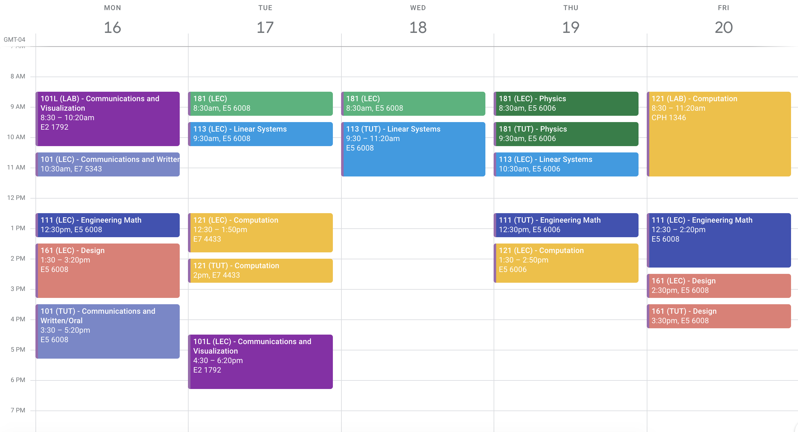

import { Link, graphql } from "gatsby"
import { AnchorLink } from "gatsby-plugin-anchor-links"
import { DetailsBlog, Blockquote } from "../../components/details.js"
import { NextPrevPosts } from "../../components/blogPost.js"
import {
  Accordion,
  AccordionItem,
  AccordionItemHeading,
  AccordionItemButton,
  AccordionItemPanel,
} from "react-accessible-accordion"
import arc from "../../images/blog/syde-1a/arc.png"
import crab from "../../images/blog/syde-1a/crab.png"
import gunship from "../../images/blog/syde-1a/gunship.png"
import knightbus from "../../images/blog/syde-1a/knightbus.png"

  <h1>{props.pageContext.frontmatter.title}</h1>

<DetailsBlog
  date={props.pageContext.frontmatter.date}
  time={props.pageContext.frontmatter.readTime}
/>

My first term of Systems Design Engineering (SYDE) at the University of Waterloo went by so quickly. It feels like just yesterday when I was moving into CMH, interviewing for my first co-op, finishing final exams, and now onto my first co-op.

Throughout this, I'm going to go over my thoughts on the academics, co-op process, and just SYDE in general.

## Academics

This is what our 1A schedule looked like.

<Accordion allowZeroExpanded>
  <AccordionItem>
    <AccordionItemHeading>
      <AccordionItemButton>SYDE 101 + 101L (Communication)</AccordionItemButton>
    </AccordionItemHeading>
    <AccordionItemPanel>
      

        These were some chill courses that kind of gave an overview of how to
        communicate as an engineer – whether it's spoken and written English, or
        visually through diagrams and such. Personally, I enjoyed 101L a lot. It
        felt like I was able to put my understanding of 3D space and design to
        the test.
      

      

        These two courses were worth only half a credit each and for the most
        part, the coursework reflected that much work. Although, I do remember
        staying at the E5 lab till late at night because I didn't have a Windows
        machine that can run Solidworks and finish creating my Arc de Triomphe
        model.
      

      

        In 101, we covered engineering communication in the form of primarily
        written communication. It was made up of weekly tutorials and a class
        seminar with guest lecturers. In the tutorials, we would read short
        texts and then write abstracts, executive summaries, or other analysis
        pieces. While it may see intimidating like high school english, it ended
        up being pretty simple and straightforward. One key thing I remember
        about this course was the chance to interact with profs on a more
        individual basis because our tutorials were composed of up to 30
        students. This meant that it felt like high school again where the prof
        might walk around and ask how we are doing.
      

      

        For 101L, we had Igor and it was one of those courses where I enjoyed
        what we were learning and doing. For this course, we often had labs
        where we worked in Solidworks and on paper in this textbook with grid
        lines and exercises. I enjoyed it since I got to draw, something that I
        missed doing in the little time I had. This was also my first time
        learning Solidworks and got me interested in the field of 3D design.
        While it was difficult at first, it ended up being fun towards the end.
      

      

        

          
          
        

        

          
          
        

      

      

        I wish we had more courses like 101L where we got to use a tool relevant
        to our industry and create things with it. I'm looking forward to SYDE
        223 where we can do some more relevant coding, and SYDE 263 which is
        engineering prototyping.
      

    </AccordionItemPanel>
  </AccordionItem>
  <AccordionItem>
    <AccordionItemHeading>
      <AccordionItemButton>SYDE 111 (Calculus)</AccordionItemButton>
    </AccordionItemHeading>
    <AccordionItemPanel>
      

        This course is basically first year engineering calculus. Note that if
        you have friends in other engineering majors, you will not be covering
        the same things in this first calculus course. Instead, get yourself
        some computer science friends since this course more closely aligns with
        their calculus course.
      

      

        In this course, we cover things like induction, derivatives, curve
        sketching, optimization, Taylor polynomials, and a few other topics.
        There were weekly quizzes and problem sets, as well as a midterm and
        final exam which made up most of our final mark.
      

      

        Some really good resources for this course were{" "}
        <a
          href="https://www.khanacademy.org"
          className="link"
          target="_blank"
          rel="noreferrer"
        >
          Khan Academy
        </a>
        , <a
          href="https://www.youtube.com/channel/UCEWpbFLzoYGPfuWUMFPSaoA"
          className="link"
          target="_blank"
          rel="noreferrer"
        >
          Organic Chemistry Tutor
        </a>, and <a
          href="https://tutorial.math.lamar.edu"
          className="link"
          target="_blank"
          rel="noreferrer"
        >
          Paul's Math Notes
        </a>. I know these along with my classmates really helped me understand the
        content and pass the course.
      

      

        For me, this was a difficult course. I finished the grade 12 math
        courses in grade 11, so I had not done math in about a year by the time
        I started university. Luckily, a lot of my notes came in handy because
        my school happened to cover some of the concepts, but there were still a
        lot of new, unfamiliar topics.
      

      

        This was the course that really helped me come to realize that marks are
        not the end of the world in university, and that while I may have had
        high marks in high school, university is a different playing field.
      

      

        That being said, I'm not great at math, nor do I really enjoy it. If you
        like the subject then this is for you since it's a good introduction to
        university level math.
      

    </AccordionItemPanel>
  </AccordionItem>
  <AccordionItem>
    <AccordionItemHeading>
      <AccordionItemButton>SYDE 113 (Linear Algebra)</AccordionItemButton>
    </AccordionItemHeading>
    <AccordionItemPanel> 
      

        Some of the topics we covered in this course include coordinate systems, conic sections, vectors, planes, and matrices. This course had lectures and interactive tutorials with marked content. It was interesting because the lectures covered certain topics and then the interactive tutorials seemed to take that content in a different direction. However, the quizzes were fairly straightforward.
      

      

        I didn't really know what to expect coming into this course, but it was different from what I expected. While this was definitely one of the more confusing courses, I tended to spend less time on it, only trying to learn the content when there were quizzes. 
      

      

       Some advice I would give about this course is to treat it like the half credit it is. While it is daunting with all the new content and possibly confusing lectures, the material that is actually marked should not be too far out there.
      

    </AccordionItemPanel>

  </AccordionItem>
  <AccordionItem>
    <AccordionItemHeading>
      <AccordionItemButton>SYDE 121 (Intro to C++)</AccordionItemButton>
    </AccordionItemHeading>
    <AccordionItemPanel> 
      

        This course was an introduction to programming and C++. It covered primative data types and how to manipulate those. If you have a background in Java, C#, Python, or TypeScript, this course should be pretty easy to pick up. It consisted of numerous labs, weekly lectures, a midterm, and a final exam. 
      

      

        I didn't really spend a lot of time on this course to be honest because I already came from a software background and luckily, Java is pretty close to C++. I can see why the course is helpful to those who do not know any programming, but it's also a breeze for people who already know. 
      

      

       Some advice I would give about this course is to try and learn some programming before coming into SYDE. This course will not be enough to get you a software co-op right off the bat in 1A if you do not know any other programming languages because the core concepts of algorithms and data structures are not taught until 223 in 1B. Also, reach out to people if you get stuck. There are probably a lot of people in your class that are willing to help you out.  
      

    </AccordionItemPanel>

  </AccordionItem>
</Accordion>

#### More posts

<NextPrevPosts
  projects={props.data.allMdx.edges}
  current={props.pageContext.frontmatter.order}
/>

export const pageQuery = graphql`
  query {
    allMdx(
      filter: { frontmatter: { date: { ne: null } } }
      sort: { order: ASC, fields: [frontmatter___date] }
    ) {
      edges {
        node {
          id
          frontmatter {
            title
            path
            type
            date
            order
            readTime
          }
        }
      }
    }
  }
`
