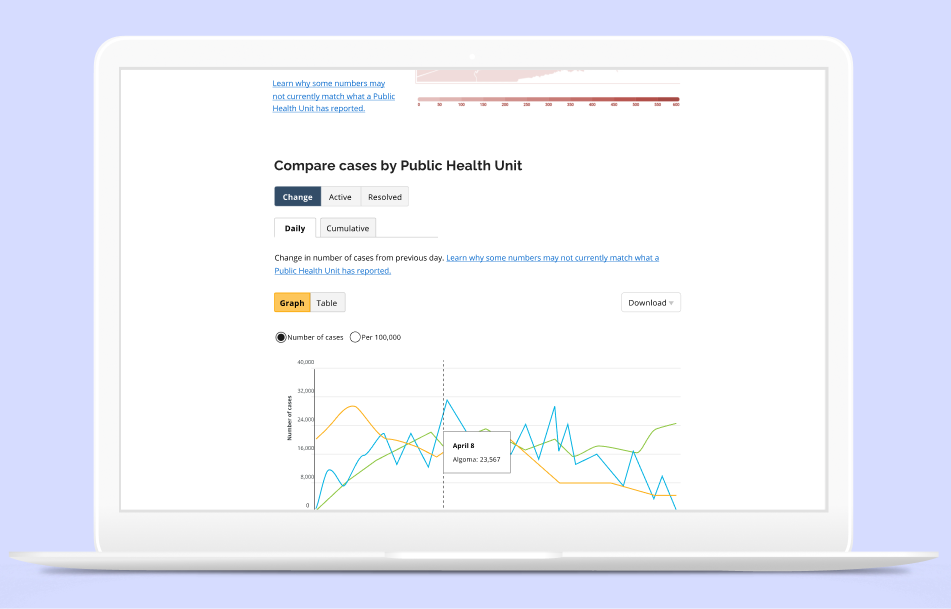
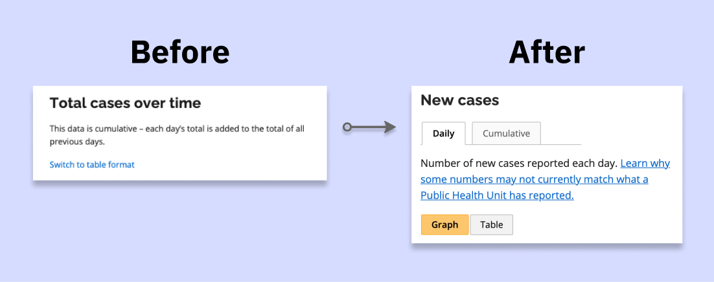
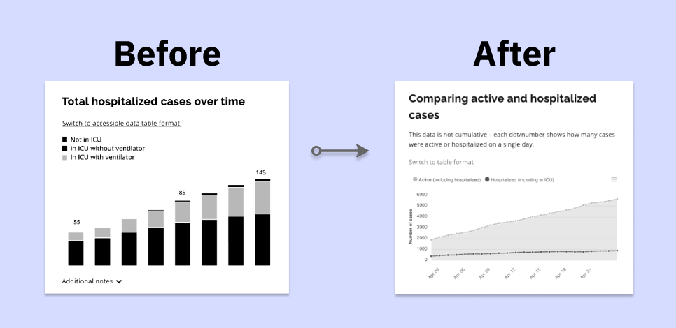
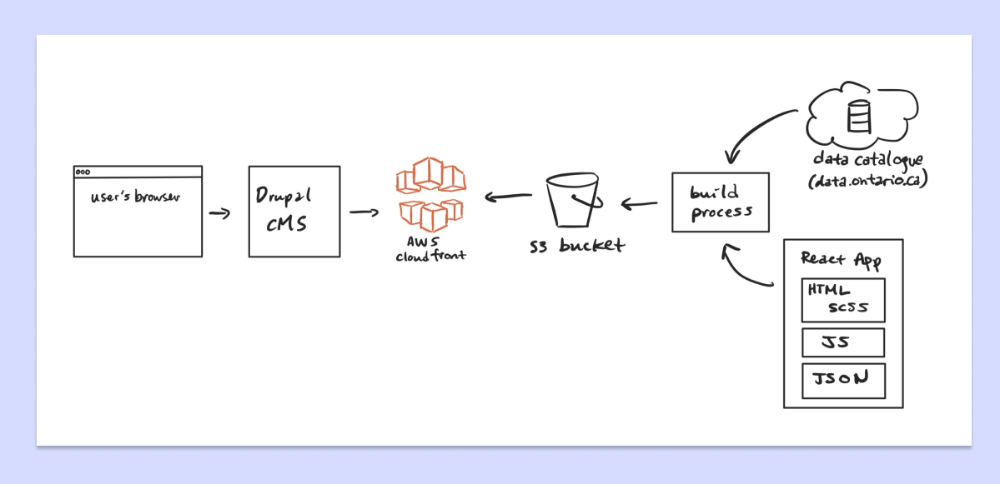

import { Link, graphql } from "gatsby"
import { AnchorLink } from "gatsby-plugin-anchor-links"
import { Details, Blockquote } from "../components/details.js"
import {
  Accordion,
  AccordionItem,
  AccordionItemHeading,
  AccordionItemButton,
  AccordionItemPanel,
} from "react-accessible-accordion"
import MoreProjects from "../components/moreProjects.js"
import table from "../images/covid-data/table.png"
import alberta from "../images/covid-data/alberta.png"
import uk from "../images/covid-data/uk.png"
import worldometer from "../images/covid-data/worldometer.png"
import toggle from "../images/covid-data/toggle.png"

  <h1 className="purple">{props.pageContext.frontmatter.shortTitle}</h1>
  <h2>{props.pageContext.frontmatter.title}</h2>

As a product design intern at the Ontario Digital Service when the COVID-19 pandemic began, I had the opportunity to design data visualizations to inform the public. Later in the same year, I returned as a full stack engineering intern to continue the development of the data visualization pages. During my internship, I helped to launch three iterations of the site to production which continues receives over 450,000 views per month, and has received international accolades. Visit the live website at <a href="https://covid-on-2020.netlify.app" className="link" target="_blank" rel="noreferrer">covid-19.ontario.ca/data</a>.

#### Context

## Problem

While the main COVID-19 microsite solved many of the issues regarding informing the public with government responses to the pandemic, the lack of comprehendible and official data related to case counts remained.

Previously, the Ministry of Health had presented the information in extremely long tables which were overly scientific, and difficult to understand for Ontarians. This problem was reinforced numerous times in the user interviews I helped to conduct for the main microsite. This is summarized by the following:  

  

    

      <h3>1. The tables were very long</h3>
      <h3>2. Difficult to understand the big picture</h3>
      <h3>3. No other official source for understandable infographics</h3>
    

  

  

    
    

      The data tables that were presented were overly long... the one here was
      just a fraction of the full table.
    

  

## Breaking down the goal

As informed by our user interviews done for the main COVID-19 website, the main idea Ontarians wanted to understand was if we were flattening the curve of COVID-19 cases. Thus, to guide our solution, we used a how might we statement:

<Blockquote
  text={
    "How might we show Ontarians how we, as a province, are flattening or not flattening the curve of the COVID-19 pandemic in a visual manner?"
  }
/>

## Our approach

  

    

      <h3 className="purple">1.</h3>
    

    

      <h3 className="purple">Research</h3>
      
User interviews

      
Competitive analysis

    

  

  

    

      <h3 className="purple">2.</h3>
    

    

      <h3 className="purple">Design</h3>
      
Information architecture

      
Low-fi designs

      
Hi-fi designs

    

  

  

    

      <h3 className="purple">3.</h3>
    

    

      <h3 className="purple">Evaluate</h3>
      
User testing

      
Design iterations

    

  

  

    

      <h3 className="purple">4.</h3>
    

    

      <h3 className="purple">Development</h3>
      
New features

      
More graphs

    

  

  

    

      <h3 className="purple">5.</h3>
    

    

      <h3 className="purple">Maintenance</h3>
      
Bug fixes

      
Optimizations

    

  

  

After the initial design prototype, the page was green-lit to proceed towards production. Using our research from user interviews done for the main COVID-19 microsite, we designed mockups for the development team to implement which we constantly iterated upon. This led to the release of the first data visualization page in May 2020.

I joined the development team during sprints leading up to the second launch in September and contributed to the maintenance of the site and additional features for the second, third, and fourth iterations. <AnchorLink to="/covid-data#design" title="Design" className="link">Jump to the final designs I helped create</AnchorLink> or <AnchorLink to="/covid-data#solution" title="Solution" className="link">the final coded version I helped launch.</AnchorLink>

#### Research

## Understanding what Ontarians want to see

When conducting user testing for the main Ontario COVID-19 microsite, I also gathered insight into what Ontarians were looking for in a data visualization.

Some of the features that the 15+ Ontarians wanted include, but were not limited to:

- easy to read and understand, preferably in a visual manner
- easy to access from the trusted Ontario COVID-19 microsite
- an overall understanding of the "curve"
- local case statuses
- understanding of testing and how many people Ontario is testing
- understanding of hospital and ICU capacity

## Analyzing other data visualizations

Ontario was definitely not the first region to be creating data visualizations to inform the public about COVID-19. Thus, we turned to other jurisdictions and websites for inspirations and interesting features we wanted to include in our own site.

Three of the main visualizations we analyzed include the <a href="https://www.alberta.ca/stats/covid-19-alberta-statistics" className="link" target="_blank" rel="noreferrer">Government of Alberta</a>, <a href="https://coronavirus.data.gov.uk" className="link" target="_blank" rel="noreferrer">Government of the UK</a>, and <a href="https://www.worldometers.info/coronavirus/country/canada/" className="link" target="_blank" rel="noreferrer">worldometers</a>. At a high level, some of the features we liked and planned to include:

- "big numbers" above the fold to highlight the important statistics
- Government of the UK has a jurisdictional breakdown of the cases on both map and table formats
- the ability to toggle between graph and table formats
- the ability to download the data
- simple presentation without superfluous footnotes
- reinforcement that this is an official source

 
<Accordion allowZeroExpanded>
  <AccordionItem>
    <AccordionItemHeading>
      <AccordionItemButton>
        See more about the other data visualizations
      </AccordionItemButton>
    </AccordionItemHeading>
    <AccordionItemPanel>
      

        

          <h3>Government of Alberta</h3>
          
          

            <a
              href="https://www.alberta.ca/stats/covid-19-alberta-statistics.htm#new-cases"
              className="link"
              target="_blank"
              rel="noreferrer"
            >
              Alberta's data visualizations
            </a>
          

        

        

          <h3>Things we liked</h3>
          
Unique visualization layouts that enhance understanding

          
Vibrant colours that are easy to differentiate

           
          <h3>Things to avoid</h3>
          
Static images

          
Confusing toolbar on interactive graphs

          
Lack of accesible format

        

      

      

        

          <h3>Government of UK</h3>
          
          

            <a
              href="https://coronavirus.data.gov.uk"
              className="link"
              target="_blank"
              rel="noreferrer"
            >
              UK's data visualizations
            </a>
          

        

        

          <h3>Things we liked</h3>
          
Big numbers

          
Brief descriptions to provide context

          
Local numbers

          
Ability to toggle between graphs and tables

          
Ability to download raw data

          
Defined colour scheme

           
          <h3>Things to avoid</h3>
          
Inefficient usage of space

          
Long page

        

      

      

        

          <h3>worldometer</h3>
          
          

            <a
              href="https://www.worldometers.info/coronavirus/country/canada/"
              className="link"
              target="_blank"
              rel="noreferrer"
            >
              worldometer's data visualizations
            </a>
          

        

        

          <h3>Things we liked</h3>
          
Big numbers

          
Simple graphs

          
Ability to toggle between linear and logarithmic modes

          
Clean tooltip

          
Comparative graphs

           
          <h3>Things to avoid</h3>
          
Inefficient usage of space

          
Not enough context per graph

          
Unsure of the official source

        

      

    </AccordionItemPanel>
  </AccordionItem>
</Accordion>

#### Design

## Brainstorming ideas

When we initially pitched the concept of the COVID-19 microsite, we also included the idea of a data visualization page. This concept can be seen below and was heavily based off sources like Alberta's COVID-19 status page and worldometers which were retrofitted with <a href="https://designsystem.ontario.ca" className="link" target="_blank" rel="noreferrer">Ontario's design system</a> patterns.  

<iframe
  style="border: 1px solid rgba(0, 0, 0, 0.1);"
  width="100%"
  height="600"
  src="https://www.figma.com/embed?embed_host=share&url=https%3A%2F%2Fwww.figma.com%2Fproto%2FE0r9HDjQWjaTA4r3aoqdpP%2FCOVID-19-data-viz-Initial-prototype%3Fnode-id%3D1%253A19%26viewport%3D543%252C703%252C0.16830630600452423%26scaling%3Dscale-down-width"
  allowfullscreen
></iframe>

 
 

We used this original concept as a jumping off point for our ideation. A great way to brainstorm is through the diverge-converge method. Individually, we sketched our ideas for what data we wanted to show and the best way to represent it. Then, we came together as a group to discuss and consolidate some of our ideas.

We also compiled a moodboard of various data visualizations we liked. This included sources from Ontario's static health updates, Alberta's data visualizations, and <a href="https://russell-pollari.github.io/ontario-covid19/" className="link" target="_blank" rel="noreferrer">Russell Pollari's dashboard</a>. All of these initial ideas can be seen in the Figma file below!  

<iframe
  style="border: 1px solid rgba(0, 0, 0, 0.1);"
  width="100%"
  height="450"
  src="https://www.figma.com/embed?embed_host=share&url=https%3A%2F%2Fwww.figma.com%2Ffile%2FSEReiybErhx9nRxHksi1qJ%2FCOVID-19-data-viz-%25E2%2580%2593-Ideation%3Fnode-id%3D0%253A1"
  allowfullscreen
></iframe>

## Creating an accessible interface

One of the main features that we ensured to include in the data visualizations was the toggle between graph and table format. This is because as a government entity, we needed to ensure that all Ontarians are able to access this information whether it is visually or through the use of a screenreader. Many sites display great data visualizations, but sometimes forget to also include tables for those who require a table format.

  

    

      The UK government had an interesting approach to this. They used radio
      buttons to control what mode they are currently in. This switch would
      control the content on the entire page, switching the data from a graph
      format to table format or vice versa.
    

    

      We looked at a number of ways we could implement this idea. This includes
      the use of radio buttons like the UK government, tabs, button groups, and
      linked text.
    

  

  

    
    

      The UK government use radio buttons to toggle between graphs and tables.
    

  

Initially, we used linked text. Then we swiched to the use of a button group. This was to help differentiate the function from links we used for definitions in the description. We chose button groups over tabs because we used tabs to create a "sheet" that flips between daily or cumulative views.  

  Before we used linked text, but then switched to button groups and tabs.

Another issue that was brought to my attention was the use of colours on data visualizations. I have the ability to see colour, so it did not occur to me that the colours we were choosing would be difficult to differentiate for colourblind users. This scenario arose during a user testing session when I interviewed a user who is colourblind brought to our attention how difficult it was for them to differentiate the items being compared since we relied on colour to separate items on the same graph.

Having never worked with data visualizations before, I found resources to help me learn how to present data in the best way for many to understand. I used <a href="https://fossheim.io/writing/posts/accessible-dataviz-design/" className="link" target="_blank" rel="noreferrer">Sarah Fossheim's introduction article</a> and <a href="https://keen.io/blog/accessibility-in-data-vis/" className="link" target="_blank" rel="noreferrer">Keen.io’s guide</a>.

The two main things I learned was to not rely on colour as a way to differentiate between items on a graph and to provide labels where possible, as well as to limit the items being presented to a minimum.  

  We worked on adding contrast to the colours so its differentiable when black
  and white.

## Continuing to iterate

As we were designing the interface, we conducted numerous rounds of user testing. This also gave the government time to collect more data to display to the public.

At the end of my internship, the data visualizations were not yet launched as development was still occurring. Below is a sample of the final designs I worked on before development finished.

<iframe
  style="border: 1px solid rgba(0, 0, 0, 0.1);"
  width="100%"
  height="600"
  src="https://www.figma.com/embed?embed_host=share&url=https%3A%2F%2Fwww.figma.com%2Fproto%2FQQv2sLouKSPVJFj3EwJozb%2FCOVID-19-data-viz-%25E2%2580%2593-end-of-design%3Fnode-id%3D1%253A3%26viewport%3D779%252C1325%252C0.41164255142211914%26scaling%3Dscale-down-width"
  allowfullscreen
></iframe>

  Design for version 1 of the data visualizations which launched in May 2020.

#### Development

## Understanding the structure of the application

I stepped into the development role in my second internship with the Ontario Digital Service in September 2020, and it was like coming back to an old friend. Having context on the COVID-19 data visualizations as a product designer helped to minimize onboarding, and I could jump right in as a developer.

One of the first things I did was understand how the overall app works. Essentially, when a user requests <a href="https://covid-on-2020.netlify.app" className="link" target="_blank" rel="noreferrer">covid-19.ontario.ca/data</a>, it gets the site information from Drupal, an open source CMS that the government of Ontaria uses widely for its static websites. This page in Drupal goes off to request the actual data visualizations on AWS cloudfront via a custom script written in the Drupal page's HTML and shows the data visualizations as if they were done inline.

The page on AWS cloudfront is served by an S3 bucket. This is kept current by a build process triggered in our Gitlab CI/CD processes. In this process, it pings the <a href="https://data.ontario.ca/en/group/2019-novel-coronavirus" className="link" target="_blank" rel="noreferrer">Ontario data catalogue</a> for the latest COVID-19 data, and processes the React app. The app is built once a day to gather the latest data.  

A high level overview of the app's structure.

By understanding the overall app, I was able to contribute to all parts of the app's stack. During my term, I learned a lot about the inner workings of browsers, how a CMS is helpful for large teams, debugging and optimizing build processes, data integrity, refactoring styles within an app, as well as structuring large applications in React.

## Creating new features and graphs

Before I got there, the team was in limbo waiting for executive approvals to continue development for a version 2 launch. However, upon joining the team, I was put to work almost immediately as we just got the go-ahead and a deadline for putting version 2 into production!

Thus, I had to quickly ramp up on the stack. Some of the libraries we used include:

- <a
    href="https://apexcharts.com"
    className="link"
    target="_blank"
    rel="noreferrer"
  >
    ApexCharts
  </a> for the graphs
- <a
    href="https://ant.design"
    className="link"
    target="_blank"
    rel="noreferrer"
  >
    Antd
  </a> for tables, buttons, and tables
- <a
    href="https://react-leaflet.js.org"
    className="link"
    target="_blank"
    rel="noreferrer"
  >
    React Leaflet
  </a> for the maps

 

For versions 2, 3, and 4, I worked on a lot of new features which include:

- Regional maps with toggable scales
- Clusters on regional maps
- Additional bar graphs and tables with numerous data layers
- Searching for a region and setting the data to a graph
- Graphs with checkboxes to set data to a graph
- Highlighting data anomalies with a custom tooltip

 

I also got to work on creating data schemas for various COVID-19 data sets. The collection of COVID-19 data sets can be seen <a href="https://data.ontario.ca/en/group/2019-novel-coronavirus" className="link" target="_blank" rel="noreferrer">here</a>.

The final outcome can be seen <AnchorLink to="/covid-data#solution" title="Solution" className="link">below</AnchorLink>. During this process, I learned a lot about React hooks, state management, debugging, and about the libraries (React Leaflet and ApexCharts).

In addition, in around October, Ontario was seeing an increase in COVID-19 cases. Ontario helped create was the COVID-19 alert app that helps with contact tracing, and government officials were promoting it heavily to help curb the spike in cases.

I was put in charge of developing a small data visualization to display statistics related to the app's downloads and usage to alert others. While creating this, I optimized the build bundle, and refactored the styles to reduce build times. It was a really good experience, as I was able to own the entire end-to-end process from setting up the repository and app structure, collaborating with the design team and product manager closely, and really solidify my fundamentals in building new graphs with our app's components.

Below is the final iteration of the COVID-19 alert app statistics gathered as of January 16th, 2021 and is live at <a href="https://covid-alert-on-2020.netlify.app" className="link" target="_blank" rel="noreferrer">covid-19.ontario.ca/covidalert</a>.  

<iframe
  style="border: 1px solid rgba(0, 0, 0, 0.1);"
  width="100%"
  height="600"
  src="https://covid-alert-on-2020.netlify.app"
></iframe>

COVID-19 alert app data visualizations

## Optimizing the site

One of the common issues we ran into as a team was the build process. Sometimes, the build would fail halfway through, or the build would take close to 10 minutes to complete! This was not sustainable and caused us to manually check each day to ensure it was successful.

To help mitigate this, I worked with the DevOps team to optimize the pipeline, automating the build proccesses to pass 96% of the time. I also worked on refactoring parts of the app to reduce the size of files, and ultimately reducing the build time by 52%. This also helped to decrease overall load times of the page by 34%.

Another major issue I helped to resolve was the overwhelming global styles that come with using the Antd components. Antd uses global styles, and while they did not overwrite completely in our application itself, it overwrote the styles the are associated with the Drupal CMS. To help mitigate this, I worked on refactoring and scoping the styles manually, also removing over 2,000 lines of duplicated CSS/SCSS code in the process.

#### Solution

## Final site

At the end of my second internship as a developer in December 2020, we were about to launch the fifth iteration of data visualizations. Below is the final iteration that I helped launch at the end of my second internship and displays data gathered as of January 15th, 2021. You can see the live site at <a href="https://covid-on-2020.netlify.app" className="link" target="_blank" rel="noreferrer">covid-19.ontario.ca/data</a>.  

<iframe
  style="border: 1px solid rgba(0, 0, 0, 0.1);"
  width="100%"
  height="600"
  src="https://covid-on-2020.netlify.app"
></iframe>

Main data visualization page

<iframe
  style="border: 1px solid rgba(0, 0, 0, 0.1);"
  width="100%"
  height="600"
  src="https://covid-on-2020.netlify.app/?page=LTC2"
></iframe>

  Data visualizations depicting long term care home data

\*Please note that some of the links may not work since they are connected to elements that would typically be included in the Drupal CMS body rather than the React app.

## Results

Shortly after my product design internship at the Ontario Digital Service, the initial data visualization page got launched. Then as a developer intern, I got to be an integral part in launching the second, third, and fourth iterations of the data visualization page.

Since its launch, the site has received:

<Blockquote text={"Over 20 million views since its launch"} />

<Blockquote text={"Numerous international accolades from other governments"} />

Overall, I believe the COVID-19 data visualizations were successful and helpful to all Ontarians in providing up to date and reliable information. My mom is one of the site's frequent visitors and she loves it!

## Next steps

Also, after the launch of the second iteration, we opened a feedback form to gain insight from Ontarians. From it, we learned that the site was really helpful in giving people an overview of COVID-19 in Ontario. We also recieved tons of amazing suggestions for improvements we could make. The team will continue to work on those suggestions.

On the product roadmap, there are plans for creating new visualizations with different data for different ministries. This includes the eventual release of visualizations for schools and childcare centres, as well as visualizations for the Ministy of the Solicitor General.

## Reflecting back

I learned a ton from working on this product. I learned everything from user research to frontend development to maintaining build processes. Not only did I get to participate in its conception, but I also got to work on new features and learn how to maintain a product after its launch.

I am proud of the overall impact I was able to make through working on Ontario's COVID-19 data visualizations. I look forward to continue working on impactful products in the future! I also worked with an amazing, supportive team! The product manager, Emily, of my team said:

<Blockquote
  text={
    '"Emily was an indispensable part of the covid-19.ontario.ca team. She showed incredible initiative and dedication during her time with us, consistently going above and beyond to ensure we delivered an amazing product for Ontarians. Her ability to debug issues and jump into unfamiliar codebases to build covid19.ontario.ca/data allowed us to make key feature enhancements to the product."'
  }
/>
– Emily Tamfo, Product Manager of <a
  href="https://covid-19.ontario.ca/"
  className="link"
  target="_blank"
  rel="noreferrer"
>
  covid-19.ontario.ca
</a>

 

#### More case studies

<MoreProjects
  projects={props.data.allMdx.edges}
  current={props.pageContext.frontmatter.order}
/>

export const pageQuery = graphql`
  query {
    allMdx(
      filter: { frontmatter: { company: { ne: null } } }
      sort: { order: ASC, fields: [frontmatter___order] }
    ) {
      edges {
        node {
          id
          frontmatter {
            title
            shortTitle
            path
            type
            order
            tags
            company
            thumbnail {
              childImageSharp {
                gatsbyImageData(
                  height: 280
                  placeholder: BLURRED
                  formats: [AUTO, WEBP]
                )
              }
            }
          }
        }
      }
    }
  }
`
