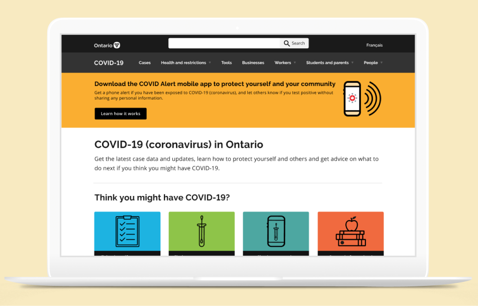
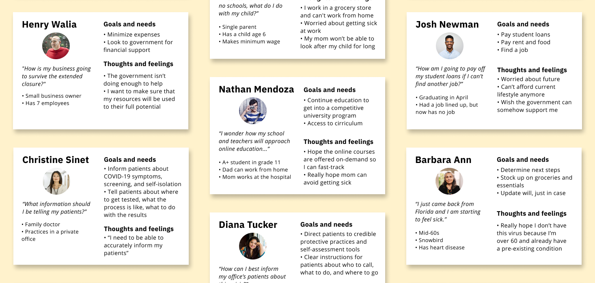
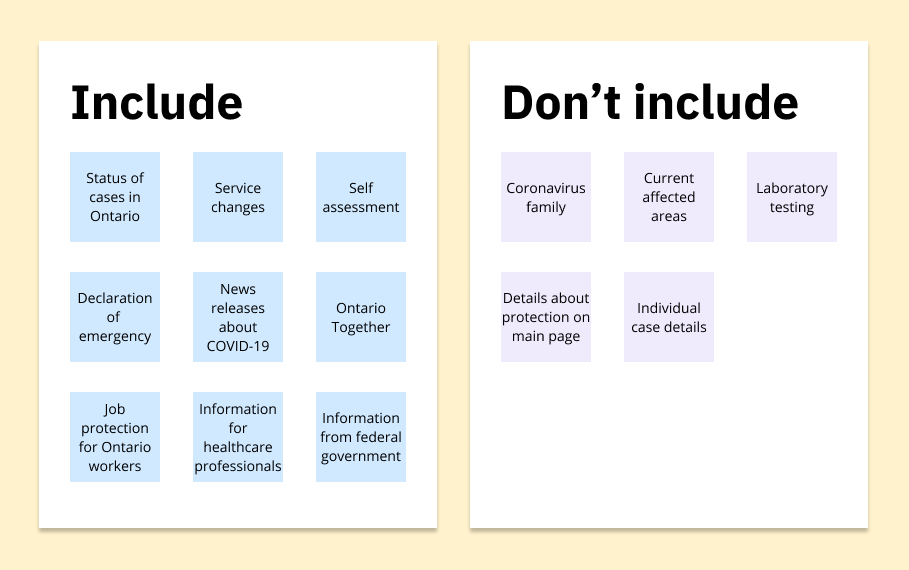
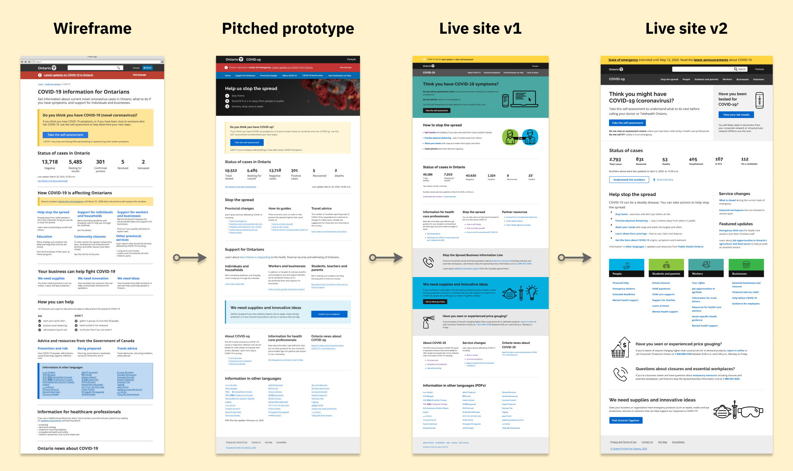
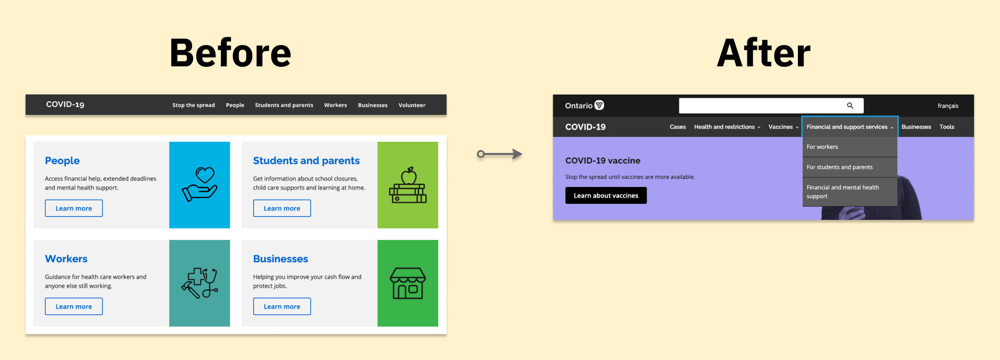

import { Link, graphql } from "gatsby"
import { AnchorLink } from "gatsby-plugin-anchor-links"
import { Details, Blockquote } from "../components/details.js"
import MoreProjects from "../components/moreProjects.js"
import kpi from "../images/kpi.png"
import initial from "../images/covid-main/initial.png"

  <h1 className="purple">{props.pageContext.frontmatter.shortTitle}</h1>
  <h2>{props.pageContext.frontmatter.title}</h2>

During my internship at the Ontario Digital Service as a product designer, the COVID-19 pandemic struck. My team was pulled in to tackle the Ontario government’s delivery of information regarding COVID-19. The final microsite received 1.25 million views in one week after launch and continues to receive over 450,000 views per month. Visit the live website at <a href="https://covid-19.ontario.ca" className="link" target="_blank" rel="noreferrer">covid-19.ontario.ca</a>.

#### Context

## Problem

With the COVID-19 outbreak, there has been information overloading Ontarians from all directions. They have difficulty identifying the important information they should know. This was particularly true on the initial version of Ontario’s COVID-19 site:

  

    

      <h3>1. The page was extremely long (much longer than this case study)</h3>
      <h3>
        2. It was densely packed with information; the entire page was one
        column with text and limited visual elements, making it difficult for
        Ontarians to find and understand the content they need
      </h3>
      <h3>
        3. The data presented had many technical nuances that confused people
      </h3>
    

  

  

    
    

      The initial COVID-19 informational page was long, text-heavy, and
      difficult to understand. This was not even a tenth of the full page.
    

  

As the Ontario government, we should ensure that Ontarians are easily finding the information they need during these unprecedented times. Our team recognized the importance of a user-friendly website for Ontarians and set out developing one.

## Breaking down the goal

To guide our product, we created the following refined problem statement and overall goal:

<Blockquote text="How might we empower Ontarians with knowledge regarding COVID-19 by streamlining our information and resources in a digestible way?" />

Due to the urgency of the situation in early March, we had three days to complete a pitchable MVP. By creating this prototype, we would accomplish:

  

    
    <h3>
      Design a page with important information that is understandable by
      Ontarians
    </h3>
  

  

    
    <h3>
      Convince executives of the need for an informative COVID-19 page for
      Ontarians
    </h3>
  

  

    
    <h3>Create a first draft and roadmap for the team we hand off to</h3>
  

## Our approach

  

    

      <h3 className="purple">1.</h3>
    

    

      <h3 className="purple">Research</h3>
      
User interviews

      
Personas

    

  

  

    

      <h3 className="purple">2.</h3>
    

    

      <h3 className="purple">Design</h3>
      
Information architecture

      
Low-fi designs

      
Hi-fi designs

    

  

  

    

      <h3 className="purple">3.</h3>
    

    

      <h3 className="purple">Evaluate</h3>
      
User testing

      
Design iterations

      
Reflection

    

  

The initial engagement for the project was 3 days in a team of 6 designers. Thus, we had to work quickly to understand our users and define a structure for the final site. After the prototype was approved by executives, I was on a team of 3 doing usability testing for the live website, reporting research insights, and assisting in the refinement of the visual design. <AnchorLink to="/covid-main#solution" title="Solution" className="link">
Jump to the final iteration I created during my internship.</AnchorLink>

#### Research

## Understanding our audience

With over 14 million people living in Ontario, the population is bound to be diverse. To inform our designs, we reached out to various individuals around the province to understand what they are looking for during these unprecedented times. This included conducting user interviews with generative questions to analyze their most prominent concerns.

Some of the questions we asked include, but are not limited to:

<Blockquote text={'"How do you feel about COVID-19?"'} />

<Blockquote text={'"What information related to COVID-19 do you seek out?"'} />

<Blockquote
  text={
    '"What COVID-19 information do you want the government to provide on their website?"'
  }
/>

We consolidated this research into a series of user personas. It gave us an overview of the different people in Ontario and the information they may be looking for regarding COVID-19.  

  Creating personas helped guide us in creating an informative site for all.{" "}
  <a
    href="https://www.figma.com/file/ZnuXm9aPWcvaeShnJxrTym/Ontario-COVID-19-Microsite-%E2%80%93-Personas?node-id=0%3A1"
    className="link"
    target="_blank"
    rel="noreferrer"
  >
    See all the personas.
  </a>

#### Design

## Structuring the site

To define the information architecture of the site, I suggested a card sorting exercise. We took the contents of the current site, and split it into two piles: to include or not to include. This is because a lot of the esiting content was irrelevant to the typical Ontarian – either it was too technical, or heavily repeated material that made the page difficult to decipher. We also ordered the material in the "include" category so that the most important information is first.  

  We had a card sorting exercise to prioritize and structure information.

This also helped us identify the content we were missing based on the findings from our user interviews. We ensured that we added these missing pieces to the structure of the website.

We started prototyping in Balsamiq first to refine the overall structure. This is when we realized the breadth of information surpassed the comfortable confines of a single web page and warranted the need for something more.

The government of Ontario has its dedicated site for all of Ontario's information. However, given the breadth and depth of information regarding COVID-19, this calls for a site on its own – a dedicated microsite for COVID-19 information. This separate site helps us cover the numerous pockets of information the different groups of Ontarians want to see as informed by our user research. Thus, <a href="https://covid-19.ontario.ca" className="link" target="_blank" rel="noreferrer">covid-19.ontario.ca</a> was born as the hub of all information related to COVID-19 for Ontario.

As such, we pitched a microsite to executives. We prototyped high fidelity mockups of the MVP in Figma. These pages were very text heavy as to ensure all the information deemed important by executives was there to help secure approval for production. You can see the pages we pitched below and see how much the current site has changed since conception!  

<iframe
  style="border: 1px solid rgba(0, 0, 0, 0.1);"
  width="100%"
  height="600"
  src="https://www.figma.com/embed?embed_host=share&url=https%3A%2F%2Fwww.figma.com%2Ffile%2FcRsZrZgPC7CzLPZ0s7RX2S%2FOntario-COVID-19-Microsite-%25E2%2580%2593-MVP-Version%3Fnode-id%3D0%253A1"
  allowfullscreen
></iframe>

## Refining the visual design

Initially, when prototyping, we solely used text and links to direct users to more specific content as guided by the typical pattern the main Ontario.ca website uses. However, as organized and concise as the content was, this still created a wall of text, making it difficult to distinguish information from one another. We added visuals to divide content further.

We also worked with the Ministry of Health to refine the visual design of the page to include branding they have created to inform the public about COVID-19. This resulted in a primarily green, blue, and teal colour scheme on the page. We also initially used a card approach to separate information groupings which helped enhance the visuals on the page.

At this point, the site was developed, and went live due to the urgency of the pandemic and the need for the government to inform the public properly.  

  The landing page was refined and evolved over time. Click the image to zoom
  in.

#### Evaluate

## Continuing to learn more

After the initial website went live, I had the opportunity to conduct usability testing and take the findings to refine the visual design of the website in a team of three. We tested the live website, and future iterations that the development team was working on at the time. I helped to recruit diverse users from all over Ontario, took notes during interviews, and facilitated over 8 interviews.

One important insight were people's thoughts on the way that information was organized. We had organized information based on the "group" of Ontarians one may fit into such as "students and parents", "workers", or "businesses". People commented that this was confusing and did not always capture all situations.

Going forward, an iteration for this was to group information based on action or type of information rather than demographics. This allows for more flexibility and inclusivity of Ontarians.

As of December 2020, the page has been updated to reflect these changes where the highest level categories are now action or categories without demographics. If needed, the subcategories cover demographics for those specific details, helping to create an information architecture that is easier to navigate and inclusive to all.  

  The grouping of information changed over time with feedback from Ontarians.
  Click the image to zoom in.

The most prominent and recurring feedback we heard was that Ontarians want to see how the virus is affecting their local area. When asked how to visualize this information, they referred to data visualizations such as heatmaps or interactive charts.

Often, this led to users wanting to see other information such as:

<Blockquote text={'"Are we flattening the curve?"'} />

<Blockquote
  text={
    '"How many hospital beds are there? Are we close to reaching capacity?"'
  }
/>

<Blockquote text={"What do the future projections look like?"} />

Ontarians wanted to see numbers and figures from a reputable source like the Ontario government.

We took our findings back to the team working on the website where they further iterated upon the design and content presented. We got enough feedback regarding the lack of data on the site and started to work on a more comprehensive data visualization page.

#### Solution

## Final designs

At the end of my first internship at the Ontario Digital Service, we had just released the second version of the homepage. However, as the pandemic has continued to evolve, the Ontario government has further iterated on the page. The most up to date version is live at <a href="https://covid-19.ontario.ca" className="link" target="_blank" rel="noreferrer">covid-19.ontario.ca</a>. Below is the final iteration of the home page that I worked on during my time on this project which was live between April and July 2020.  

<iframe
  style="border: 1px solid rgba(0, 0, 0, 0.1);"
  width="100%"
  height="600"
  src="https://www.figma.com/embed?embed_host=share&url=https%3A%2F%2Fwww.figma.com%2Fproto%2Fz3CaWo23OqcgPVO0jY5zef%2FOntario-COVID-19-Microsite-%25E2%2580%2593-Final-Version%3Fnode-id%3D1%253A8%26viewport%3D479%252C354%252C0.23687893152236938%26scaling%3Dscale-down-width"
  allowfullscreen
></iframe>
 
 

This iteration of the landing page had many notable features:

1. Call-to-actions regarding testing for COVID-19 including a self-assessment and method to view lab results
2. Brief overview of cases in Ontario that links to a more detailed data page
3. General guidelines to stop the spread of COVID-19
4. A dedicated news update so Ontarians can stay informed
5. Detailed information for the demographic they belong in

Each of the links take the user to a page within the microsite with more detailed information that is presented in the typical Ontario.ca format with similar branding. This reduces the cognitive load on users and ensures they trust the information they are looking at.

## Results

After the initial three day engagement, our prototype was approved by executives which led to the launch of the live website not too long afterwards for which I helped do user research and refinement of visual design for.

When conducting user testing after launch, we found that our site met the initial goals we set out to accomplish, including creating an easily digestible page with important information for Ontarians. Also, the page became well viewed with the following metrics:

<Blockquote text="1.25 million views in the week after launch" />

<Blockquote text="450,000 views per month on average" />

Overall, I believe our microsite was successful and serves as a great up-to-date resources for Ontarians to reference when seeking information regarding COVID-19.

## Next steps

As the pandemic continues to unfold, the site needs to stay current. This includes adding information regarding testing, lockdown procedures, and vaccines when they come out.

One thing we heard from Ontarians is that they seek verified data regarding the number of cases in Ontario. A next step is to publish data regarding the status of cases in Ontario in a visual format. Gratefully, I also had the opportunity to work on this aspect of the microsite. <Link className="link" to="/covid-data">Learn more about my work on Ontario's COVID-19 data visualizations.</Link>

## Reflecting back

These really were difficult times for many Ontarians. I spoke with individuals from across Ontario. I heard their unique stories, and learned how I can help. Each interview showed me how difficult it is to design a website meant to be accessible since the COVID-19 pandemic affects everyone. I am honoured to have had the opportunity to help design a resource that many can turn to in these times of need.

 

#### More case studies

<MoreProjects
  projects={props.data.allMdx.edges}
  current={props.pageContext.frontmatter.order}
/>

export const pageQuery = graphql`
  query {
    allMdx(sort: { order: ASC, fields: [frontmatter___order] }) {
      edges {
        node {
          id
          frontmatter {
            title
            shortTitle
            path
            type
            order
            tags
            company
            thumbnail {
              childImageSharp {
                fluid(maxWidth: 900) {
                  ...GatsbyImageSharpFluid
                }
              }
            }
          }
        }
      }
    }
  }
`
