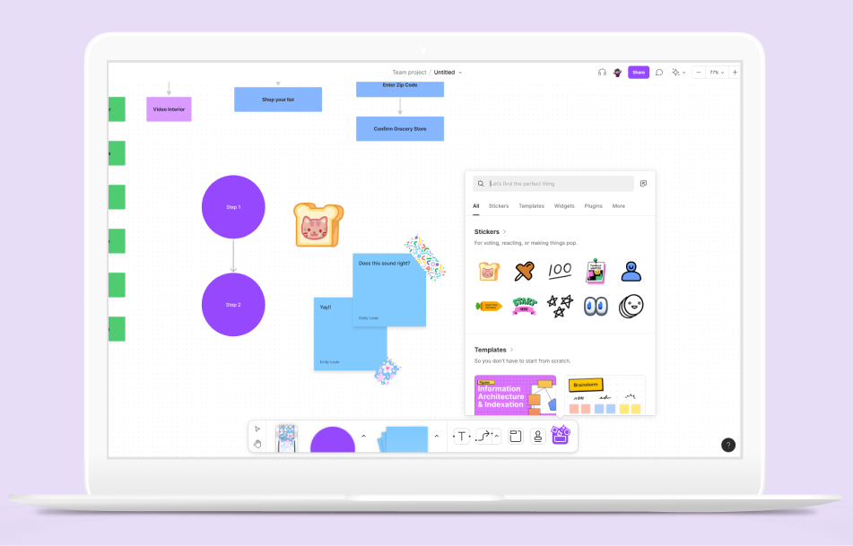
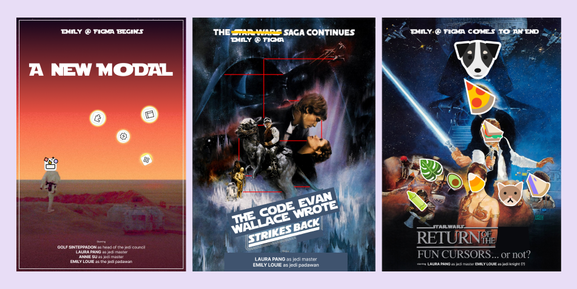
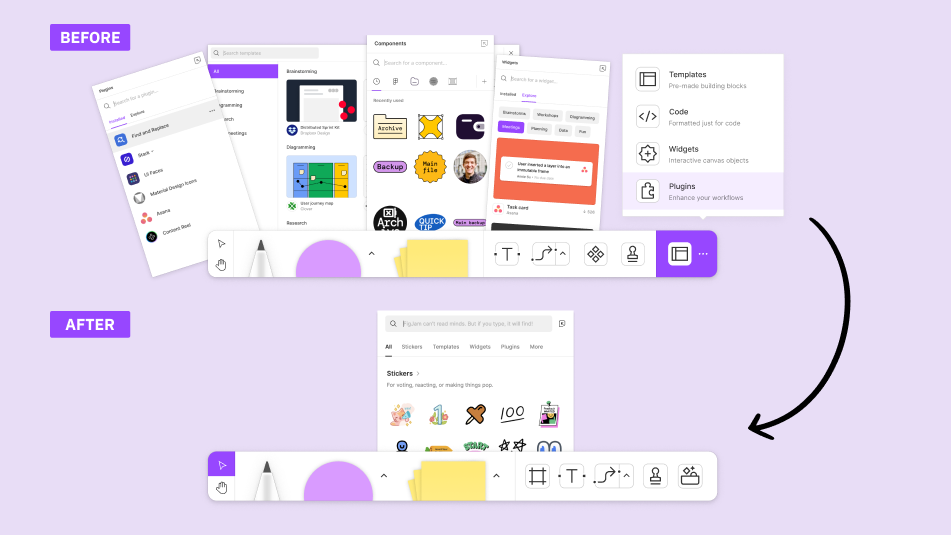
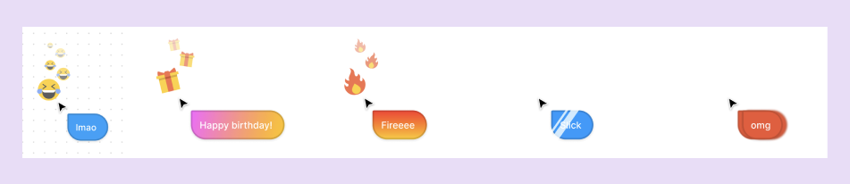
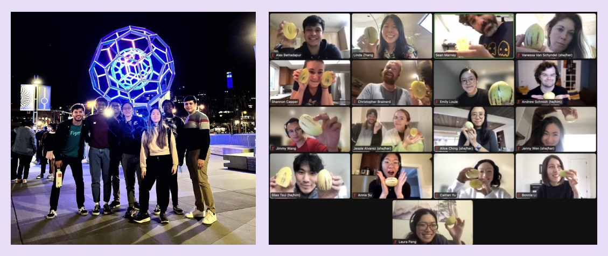

import { Link, graphql } from "gatsby"
import { Details, Blockquote } from "../components/details.js"
import {
  Accordion,
  AccordionItem,
  AccordionItemHeading,
  AccordionItemButton,
  AccordionItemPanel,
} from "react-accessible-accordion"
import MoreProjects from "../components/moreProjects.js"
import snap from "../images/figma/before-after-snap.gif"
import slick from "../images/figma/slick-animation.gif"

  <h1 className="purple">{props.pageContext.frontmatter.shortTitle}</h1>
  <h2>{props.pageContext.frontmatter.title}</h2>

I joined the FigJam team at Figma as a software engineering intern in San Francisco, California. The team's mission is to help make FigJam the best online whiteboarding tool through key product pillars such as delight and collaboration. During my internship, I helped to launch 3 projects, one of which was highlighted for FigJam's first year anniversary.

#### What did I do?

 
 

Throughout my internship, I worked on 3 main projects:

1. Creating a consolidated entry point for all of FigJam's resources (widgets, plugins, templates, and stickers)
2. Refining the snapping and guideline logic in FigJam so that users have a more informative experience
3. Spearheaded emotive reactions and custom CSS animations when keywords are typed into cursor chat for FigJam's one year anniversary

 

A summary of my epic adventure at Figma

It was a really cool experience getting to work so collaboratively with others and being staffed as a full-time engineer on the team. In these projects, I worked with 1-3 other software full-time engineers, 1 product designer, and 1 product manager.

## Magic Modal

Initially, in FigJam, the toolbar had 4 different buttons to access the different resource modals of widgets, plugins, templates, and stickers. There was no way to search between the modals and overall made it confusing for users since there were too many entry points. In order to improve the overall experience, the team aimed to consolidate all of these modals into the "magic box" which encompasses all of the resources.

 

The before and after of the modals in FigJam.

For this project, I worked with Golf, Laura, and Annie for 6 weeks. I took ownership in creating the contents of the templates tab in the modal. The project was primarily done in React TypeScript and I learned some more about using React hooks and using functions written in the C++ layer in the web layer.

 

## Snapping

The next project I worked on was refining the snapping and guideline logic in FigJam. Previously, FigJam showed a simplified version of Figma's guideline logic by removing the crosses on the gaplinees, and removing the measurement labels. However, this was still quite complicated for the average FigJam user since there is less of a need to have precise measurements for diagramming as opposed to high fidelity design work. The goal of this project was to reduce the complexity of the snapping and guideline logic in FigJam so that is it easy to use.

This project was scoped for 4 weeks, and I worked with Laura. I learned a lot about pair programming, the C++ layer of the codebase, and reading existing code that had been written many years ago. This project was one of the first times I was able to use my knowledge of data structures and algorithms in a real scenario which was interesting to see.

Some of the modifications that I worked on were changing the colours of the lines to a more chill blue and purple as opposed to an aggressive red, adding perpendicular bars to the gaplines to make it easier identify that they are gaplines, and showing guidelines for only certain node types.

  The before and after of the snapping and guideline project.

## Fun Cursor Chat

The last project I worked on was quite ambiguous at first - with only the goal of creating something delighful and collaborative for FigJam's first year anniversary. This feature was to be launched on April 21st and demoed in a livestream to celebrate the product.

At first, the project was scoped to recreate fun cursors which was an April Fun Day feature launched in 2020. However, with more consideration as to the objectives of the project, it was decided to put that feature on hold and instead create fun cursor chat. When users type in cursor chat and trigger certain keywords, emojis and animations are shown in real time to all users in the file.

 

Mockups of the different fun cursor chat options

I worked on this project with Laura and while the project was scoped for 4 weeks, 2 of those weeks were used to prototype fun cursors before it got scrapped and the remaining 2 weeks were used to build out fun cursor chat instead.

For this project, I got to take ownership in setting up the triggering system in TypeScript, as well as building out some of the custom animations in CSS. One of my favourite animations that I worked on was the glare animation that shows up on keywords like "clean" or "slick". It was a lot of fun to build in an hour or two. I really enjoyed this project overall because of how I got to work closely with designers and product managers to refine the idea into a shippable product.

  The slick animation for fun cursor chat.

#### Wrapping it up

 
 

Working at Figma was one of my favourite experiences ever! I got to explore San Francisco, meet amazing people, have a lot of impact by shipping 3 projects, and learn so much while I was there. I'm so proud of what I got done and I can't wait to be back to continue the epic saga.

  Shoutout to the rest of the Figma winterns and to the FigJamFam!

 

#### More case studies

<MoreProjects
  projects={props.data.allMdx.edges}
  current={props.pageContext.frontmatter.order}
/>

export const pageQuery = graphql`
  query {
    allMdx(
      filter: { frontmatter: { company: { ne: null } } }
      sort: { order: ASC, fields: [frontmatter___order] }
    ) {
      edges {
        node {
          id
          frontmatter {
            title
            shortTitle
            path
            type
            order
            tags
            company
            thumbnail {
              childImageSharp {
                gatsbyImageData(
                  height: 280
                  placeholder: BLURRED
                  formats: [AUTO, WEBP]
                )
              }
            }
          }
        }
      }
    }
  }
`
