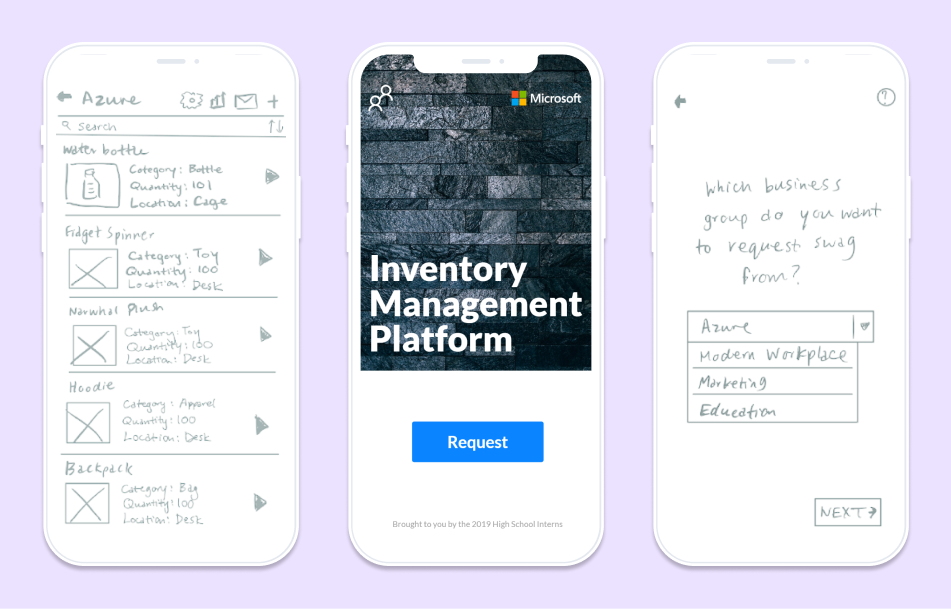
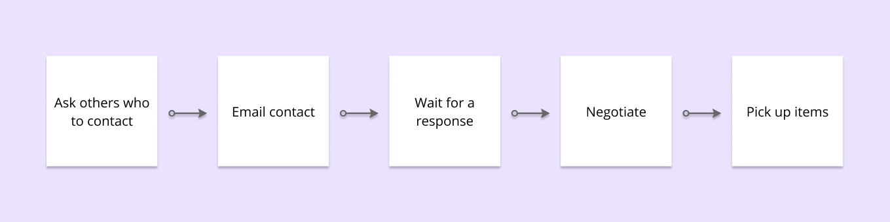
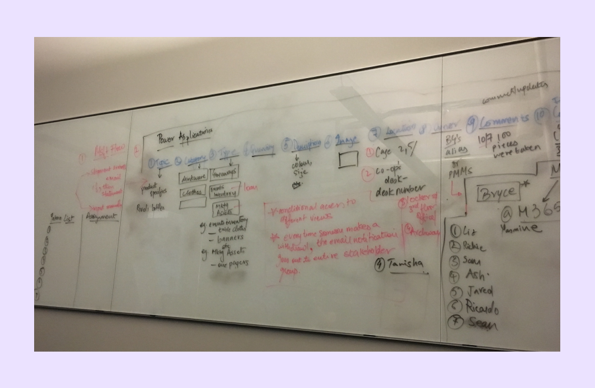
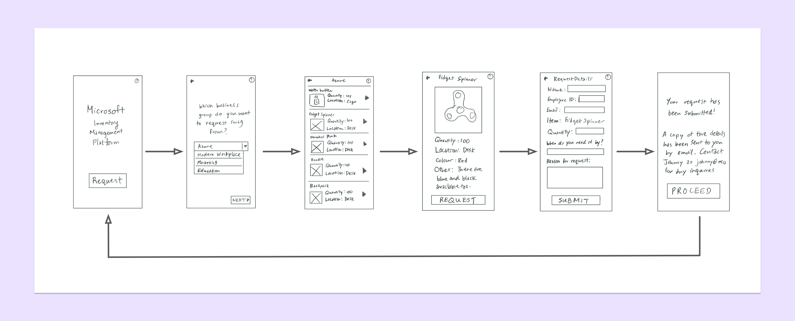
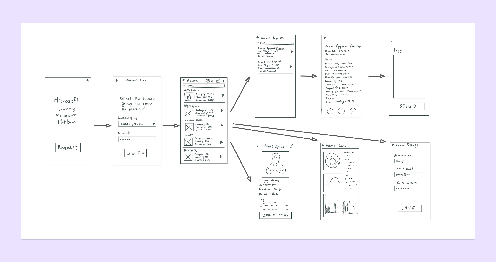
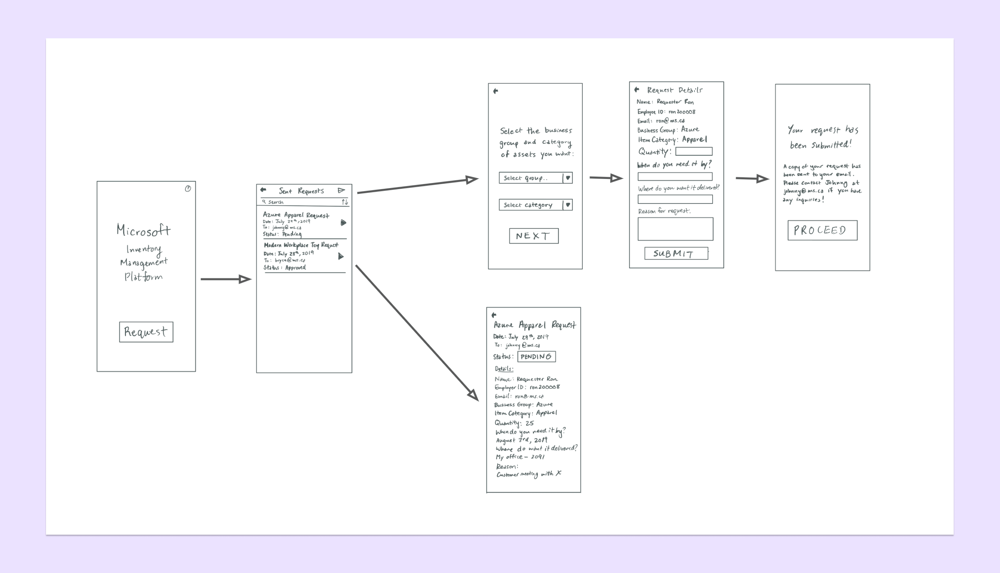
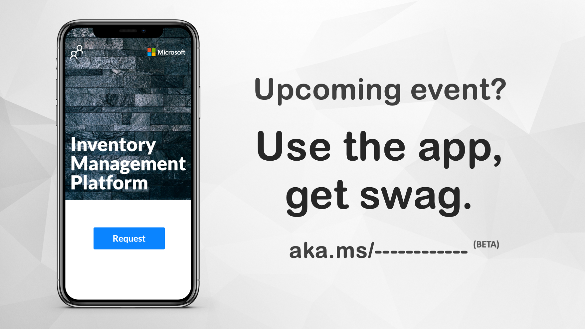

import { Link, graphql } from "gatsby"
import { AnchorLink } from "gatsby-plugin-anchor-links"
import kpi from "../images/kpi.png"
import ron from "../images/microsoft/ron.png"
import addie from "../images/microsoft/addie.png"
import { Details, Blockquote } from "../components/details.js"
import MoreProjects from "../components/moreProjects.js"

  <h1 className="purple">Microsoft Inventory Management</h1>
  <h2>{props.pageContext.frontmatter.title}</h2>

  <h3>
    This project is under an NDA, thus there are many details removed from this
    case study.
  </h3>

All companies, including Microsoft, have marketing assets, otherwise known as swag. Not only can employees request swag, but administrators also need to organize and manage their inventory. As a design and developer intern at Microsoft, I worked with my team to create an internal inventory management platform to help the organization of over 2000 employees perform these basic management actions, helping to streamline the overall workflow by 85%.

#### Context

## Initial problem

As an intern, I stumbled across the problem that catalyzed this project when I was trying to get my hands on some Microsoft swag. When I went to request some, I ran into two problems:

  <h3>
    1. We had no idea who to contact, and the others we asked did not know
    either.
  </h3>
  <h3>
    2. When we sent an email request, we did not hear back for more than a week.
  </h3>

Overall, this was a systemic problem as there was no clear organization for marketing assets among the entire company location. This made it hard for anyone to locate and get access to these assets which are meant to be used.

Having discovered the problem, I took it upon myself and my team to create something that would help manage the company and make their lives easier when requesting marketing assets.

<Blockquote text="How might we design an application to reduce wasted time and confusion of employees when requesting physical marketing assets by creating a standardized process for requesters?" />

While we started off with this initial problem statement, this was later revised after user testing. <AnchorLink to="/microsoft#revised-problem" title="Revised problem" className="link">
Jump to learn why.</AnchorLink>

To measure our success, I set the following key performance indicators:

  

    
    <h3>Reduce overall processing times to less than a week</h3>
  

  

    
    <h3>Increase employee awareness and utilization of marketing assets</h3>
  

Due to the limited timeline of the project, I focused on creating an MVP for the requesting process. After learning some more about the administrator's role in the process, the product's scope expanded to include the management process as well.

## My approach

  

    

      <h3 className="purple">1.</h3>
    

    

      <h3 className="purple">Research</h3>
      
Analyze current process

      
Personas

    

  

  

    

      <h3 className="purple">2.</h3>
    

    

      <h3 className="purple">Design</h3>
      
Ideation

      
Med-fi designs

      
Hi-fi designs

      
Coded product

    

  

  

    

      <h3 className="purple">3.</h3>
    

    

      <h3 className="purple">Evaluate</h3>
      
User testing

      
Revised problem

      
Design iterations

      
Reflection

    

  

As the sole designer and a core leader of the team, I got to plan the project's schedule and phases. This was also my first time working in an environment where I got to set the pace and I learned a lot about the process in creating a product.

With the above approach, we designed and developed a inventory management platform for employees to request and manage internal marketing assets. It helped to standardize the overall process and streamline the organization process. <AnchorLink to="/microsoft#solution" title="Solution" className="link">
Jump to the solution.</AnchorLink>

#### Research

## Analyzing the current process

Having gone through the difficult process of requesting marketing assets myself, I wondered if this was the same experience that all the other employees also went through. After conducting numerous user interviews with employees in the business group divisions, I found the process was very similar to my own experience, validating that something needs to be done about it.

From these interviews, I created a consolidated user journey map. While it may seem short, this process typically takes upwards of 10 business days to complete, making it very difficult for employees who need their marketing assets in a hurry to show customers their appreciation.  

  I created a simplified overview of the current user journey.

## Focusing on the user's needs

While conducting over five user interviews, I also summarized my findings into a user persona of a typical requester, including their goals, pain points, and understanding of the overall system. This helped remind us who we were building this product for and also helped us ensure that we address all of their needs with this product.

The persona is an employee looking to request marketing assets to present as customer appreciation at their client's closing meeting next week. However, with the current system, the requesting process is confusing and with a tight deadline, users are frustrated at how difficult it is to locate the administrator of the swag they are trying to request from.   

  

    <h3>Requester Ron</h3>
    
Owner of a Microsoft business group

    
  

  

    <h3>Goals</h3>
    
Convince clients to licence and use Microsoft tools and services

     
    <h3>Pain points</h3>
    
Locating administrator of assets

    
Trouble negotiating with administrator

    

      Difficulty receiving marketing assets to demonstrate client appreciation
    

  

 

Overall, this persona summarized the goals and pain points of individuals who request marketing assets. This helped us empathize with the user and set our team's north star that we aimed towards.

#### Design

## Ideating as a group

I led a group brainstorming session where we whiteboarded potential ideas. We utilized design techniques like Crazy 8’s and then consolidated all the different ideas into a foundational idea which we all agreed upon and would build off of in our medium fidelity prototype.

To further flesh out our idea, we mapped our the user flow. This helped keep the developers informed and contributing to the design process too.  

  We brainstormed as a group, mapping out the user flow.

## Creating a medium fidelity prototype

To consolidate our ideas into a tangible interface, I created medium fidelity mockups in Figma. This was my first time using Figma so there were a number of challenges that I encountered as I was learning on my own. Some of the difficulties included creating reusable components, and creating interactions.

The main features include a gallery of selectable items, and writing custom messages to the administrator. This makes it feel natural, similar to an online shopping experience combined with an application form.  

  I created Figma mockups for each screen in the flow. Here, they have been
  recreated to omit certain details.

The mockups provided a basis for the development team to begin creating the application, while I continued iterating on the initial prototype and user testing.

#### Evaluate

## Testing with employees

To test this application, I worked with the employees I interviewed earlier for user research. Here, I was able to assess whether their initial concerns were mitigated with this product.

Overall, the application addressed all of their goals and pain points, streamlining the requesting process.

From these sessions, I learned that I forgot a main stakeholder and potential user of this application: the administrator. This is important because the administrator can also potentially utilize the application to manage the marketing assets and contain the entire requesting process within the application. As a result, these findings definitely called for a revision of the user flows and features.

Gratefully, I implored a "test early and often" approach and we were able to catch this oversight in the third week of the project, leaving enough time to iterate and create a more encompassing product.

## Revised problem

<Blockquote text="How might we design an application that will reduce time wasted and confusion when employees are requesting physical marketing assets by standardizing the process for requesters, as well as allow administrators to organize assets and quickly respond to requests?" />

## Designing for a two-fold problem

To further understand the role of an administrator in the overall process of reqeusting and managing swag, I interviewed a number of employees responsible for managing the marketing assets in their business group. This helped me understand their day-to-day, responsibilities, and journey when undertaking a request – ultimately, constructing a persona through these learnings.

 

  

    <h3>Admin Addie</h3>
    
Manager of marketing assets in their business group

     
    
  

  

    <h3>Goals</h3>
    
Complete the jobs they were hired for

    
Assist with managing the business group's marketing assets

     
    <h3>Pain points</h3>
    
Keeping track of the business group's marketing assets

    
Responding to numerous requests of marketing assets

    
Managing new order of marketing assets

  

 

After understanding the administrator, I created additional medium fidelity mockups and continued user testing to iterate on the prototype and ensure their pain points are addressed and the product helps them to reach their ultimate goals. Thus, the product was extended to encompass both an administrator portal, and a requesting flow.

#### Solution

## Final designs

Administrator flow recreated.

Requester flow recreated.

The final application includes features for both administrators and requesters. For administrators, there is a login page to provide secure access to asset and request information including inventory counts, request data visualizations, and an inbox of requests. For requesters, there is a history of requests identified by the user's Microsoft login, as well as a simple request form that simplifies and provides direction for negotiations.

I created all of the designs and worked on the frontend of the application as well. I also helped lead the team and scope out the product.

## Results

With some final touches on the code and additional user testing, we released the beta version of the application within the office of over 2,000 employees. Upon release, we measured our KPIs and it exceeded our expectations. The final metrics include:

  

    
    <h3>Streamlined the overall process, reducing processing times by 85%</h3>
  

  

    
    <h3>Engaged employee usage, increasing requests made by 216%</h3>
  

To promote our release and encourage onboarding, I designed a series of advertisements that were shown around the office.  

  The horizontal advertisement I created shown on TVs throughout the building.
  Full link has been removed.

In addition, our project team was invited to speak at Microsoft Canada's National Annual General Meeting in September 2019. At the conference, we presented the product in front of 800 employees and received a lot of positive feedback.

## Next steps

Even though we released the beta version of the platform, there are a few improvements that can be made in the future. With this in mind, we left our project successors with a few items that they may choose to address in future iterations of the application:

  <h3>
    1. Include a shopping cart approach to allow for multiple items to be
    requested
  </h3>
  

    Currently, there is only the ability to request a single type of item due to
    our time constraints. By allowing more items to be requested at once, users
    are able to streamline their requesting process even more.
  

  <h3>
    2. Allow for the negotiation of a request to be transferred back and forth
  </h3>
  

    An important aspect of the requesting process is for administrators to reply
    back with a counteroffer. While this can be done over email, emails can get
    lost, so an opportunity to improve the app is to open a chat once a request
    has been made.
  

  <h3>
    3. Enable administrators to upload invoices to automatically update
    inventory numbers
  </h3>
  

    To further reduce the amount of manual data entry that happens with managing
    inventory, a further iteration could use AI integrations to recognize order
    receipts and automatically update inventory.
  

## Reflecting back

Working on this project at Microsoft was eye-opening. It was my first project with a large team for a large corporation, and I learned so much throughout the two months there. Three of the most important things I learned include:

  <h3>1. Conducting thorough research before starting</h3>
  

    In this project, we missed a key stakeholder early on, resulting in an
    incomplete scope for the application. Now, I know that I need to conduct
    more user tests and keep an open mind before committing to a solution right
    away.
  

  <h3>
    2. Ontarians were confused by the questions being asked and the redundancy
    of information being asked of them
  </h3>
  

    For the application to become a reality, there must be clear communication
    between designers and developers. This means constantly looping in the
    developers with the process and what is coming down the pipeline.
  

  <h3>3. I can make an impact – even as an intern</h3>
  

    I quickly learned that even as an intern, I can incite positive change
    within an organization as large as Microsoft as long as I have the passion
    and dedication to do so!
  

Overall, I am proud of the work that we were able to accomplish as a team, and especially as interns, created something that has an impact on an organization like Microsoft!  

 

#### More case studies

<MoreProjects
  projects={props.data.allMdx.edges}
  current={props.pageContext.frontmatter.order}
/>

export const pageQuery = graphql`
  query {
    allMdx(sort: { order: ASC, fields: [frontmatter___order] }) {
      edges {
        node {
          id
          frontmatter {
            title
            shortTitle
            path
            type
            order
            tags
            company
            thumbnail {
              childImageSharp {
                fluid(maxWidth: 900) {
                  ...GatsbyImageSharpFluid
                }
              }
            }
          }
        }
      }
    }
  }
`
