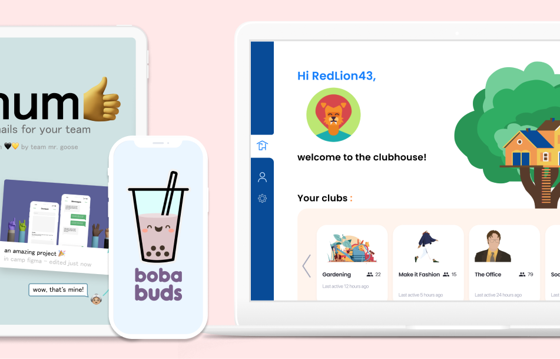
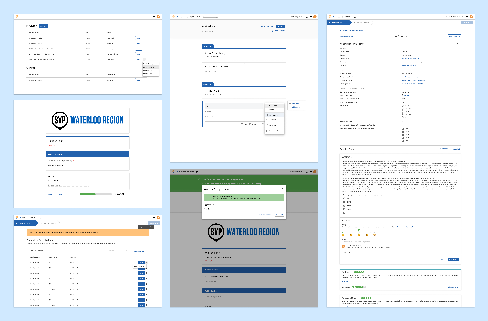
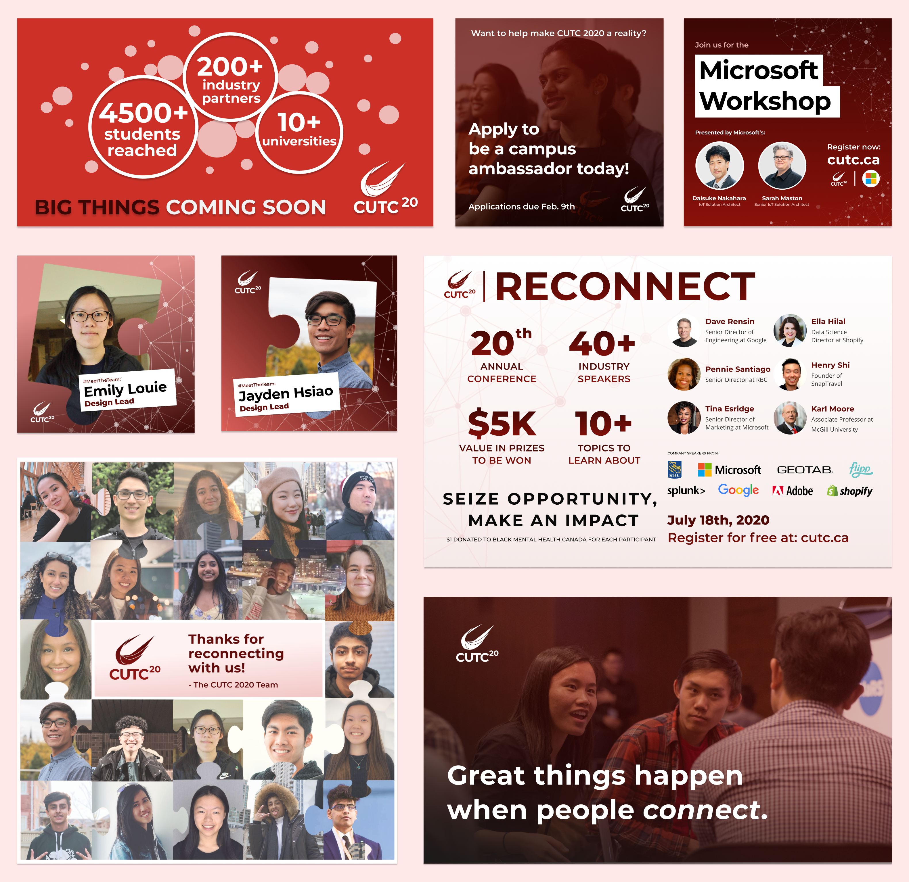
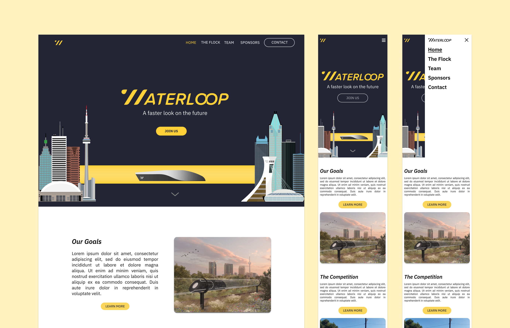

import { Link, graphql } from "gatsby"
import { DetailsProject, Blockquote } from "../components/details.js"
import { AnchorLink } from "gatsby-plugin-anchor-links"
import MoreProjects from "../components/moreProjects.js"

  <h1 className="purple">{props.pageContext.frontmatter.shortTitle}</h1>
  <h2>{props.pageContext.frontmatter.title}</h2>

 

Throughout my journey so far, I have had the opportunity to work on a lot of projects with others including projects for the community, as well as cool hackathon and designathon projects. These have helped me give back to the community using my skills in design and development, and continue learning new things in collaborative, interdisciplinary teams.  

### Table of contents

**Community**

1. <AnchorLink to="/otherprojects#arbitrium" title="arbitrium" className="toc">
     Arbitrium – Blueprint
   </AnchorLink>

2. <AnchorLink to="/otherprojects#cutc" title="CUTC" className="toc">
     Reconnect 2020 – Canadian Undergraduate Tech Conference (CUTC)
   </AnchorLink>

3. <AnchorLink to="/otherprojects#waterloop" title="waterloop" className="toc">
     Team Website – Waterloop
   </AnchorLink>

**Projects**

1. <AnchorLink to="/otherprojects#clubhouse" title="Clubhouse" className="toc">
     Clubhouse – uXperience | Think Privacy
   </AnchorLink>

2. <AnchorLink to="/otherprojects#thum" title="Thum" className="toc">
     thum – Camp Figma
   </AnchorLink>
3. <AnchorLink to="/otherprojects#bobabuds" title="boba buds" className="toc">
     boba buds – Starterhacks
   </AnchorLink>
    
    
    

# Community

#### Blueprint

## Arbitrium

<DetailsProject
  role={"1 of 2 designers on team of 11"}
  timeline={"Sep - Dec 2020"}
  skills={[
    "Product thinking",
    "Prototyping",
    "Product design",
    "Frontend development",
  ]}
/>

On my first term as a product designer at <a href="https://uwblueprint.org"  className="link" target="_blank" rel="noreferrer">Blueprint</a>, a student club at the University of Waterloo building digital solutions for non-profits, I helped to design Arbitrium, a decision workflow application. This helps organizations like <a href="https://www.socialventurepartners.org/waterloo-region/"  className="link" target="_blank" rel="noreferrer">Social Ventures Partners</a> to streamline their non-profit selection process when deciding which organizations in the community to invest time, money, and professional expertise in.

The project began in fall 2019 and I joined a year later after most of the branding and initial project structure was already designed. I worked on the administrative form creation flows and polishing up other microinteractions on the application. I also helped out with some of the frontend development in React at the end of the project. So far, the application has helped allocate over 2 million dollars in funds to non-profits in need, and has over 50 active users. I am excited to see where the application goes next! See some of the final screens in the image below.  

  Various final screens for Arbitrium. Click the image to zoom in.

#### CUTC

## Reconnect 2020

<DetailsProject
  role={"1 of 2 lead designers"}
  timeline={"Dec 2019 - Jul 2020"}
  skills={["Brand design", "Graphic design", "Web design"]}
/>

Reconnect 2020 was the 20th edition of the annual Canadian Undergraduate Technology Conference, and I had the pleasure of co-leading the design team that year. I worked with the team to develop Reconnect's visual concept, created marketing materials, and co-designed the conference's <a href="https://2020.cutc.ca"  className="link" target="_blank" rel="noreferrer">website</a>. Below is a sample of my contributions to the 2020 conference. I am excited to continue my role on the 2021 edition of CUTC!  

  Sample of my contributions to Reconnect 2020. Click the image to zoom in.

#### Waterloop

## Team Website

<DetailsProject
  role={"Lead designer"}
  timeline={"Feb - Dec 2020"}
  skills={["Web design", "Product design"]}
/>

Waterloop is the University of Waterloo's Hyperloop team aiming to design and build a scalable Hyperloop pod by 2025 to ultimately revolutionize the transportation industry. As part of the effort to rebrand our Waterloop team website and attract more sponsors and new recruits, I built onto the initial designs that <a href="https://timyhe.com" className="link" target="_blank" rel="noreferrer">Tim He</a> and <a href="https://www.linkedin.com/in/erinly/" className="link" target="_blank" rel="noreferrer">Erin Ly</a> created in summer 2019. I also worked on the designs for the content management system behind the website, making it easy for the marketing team to update the website. <a href="https://teamwaterloop.ca" className="link" target="_blank" rel="noreferrer">Check out the redesigned live website.</a>  

Final landing page designs for desktop and mobile.

 

# Projects

#### uXperience | Think Privacy

## Clubhouse (1st place)

<DetailsProject
  role={"1 of 5 designers"}
  timeline={"Oct 2020 (48 hours)"}
  skills={["Product thinking", "Prototyping", "Product design"]}
/>

Clubhouse is a secure, privacy-conscious online platform to build student communities. Especially during difficult and distant times such as the pandemic, Clubhouse aims to create a safe space for student extracurriculars online. This helps students meet others and bond over their mutual interests, overall creating a sense of togetherness in a moderated space.

I helped come up with the initial problem space and analyzed the potential market for it. I also participated in ideation, high fidelity prototyping, and creating the pitch and slidedeck.

This project was submitted to the <a href="https://devpost.com/software/clubhouse-l203nm" className="link" target="_blank" rel="noreferrer">uXperience | Think Privacy competition</a> hosted by the University of Waterloo where we were awarded 1st place! You can view our pitch and prototype of the application below.   

<iframe
  width="100%"
  height="500"
  src="https://www.youtube.com/embed/Ov1Ne9w1pEE"
  frameborder="0"
  allow="accelerometer; autoplay; clipboard-write; encrypted-media; gyroscope; picture-in-picture"
  allowfullscreen
></iframe>

<iframe
  style="border: 1px solid rgba(0, 0, 0, 0.1);"
  width="100%"
  height="700"
  src="https://www.figma.com/embed?embed_host=share&url=https%3A%2F%2Fwww.figma.com%2Fproto%2FSZAh5DsChjkNTd4A7r0Sjn%2FuXperience-Think-Privacy-Clubhouse-Copy%3Fnode-id%3D102%253A43599%26viewport%3D5110%252C386%252C0.21072734892368317%26scaling%3Dscale-down"
  allowfullscreen
></iframe>

#### Camp Figma

## thum – thumbnails for your team

<DetailsProject
  role={"1 of 4 designers and 1 of 2 developers in team of 5"}
  timeline={"Aug 2020 (48 hours)"}
  skills={["Product design", "Frontend development"]}
/>

thum is a Figma plugin that helps create inclusive thumbnails for your team's Figma files. It uses the <a href="https://www.handz.design" className="link" target="_blank" rel="noreferrer">handz</a> library to represent teammates who worked on the project a create an aesthetic cover thumbnail. I was a designer and developer on this project, using Figma to plan the user flow and React to develop the plugin. This was submitted to Camp Figma, a Figma designathon/hackathon. <a href="https://github.com/emilyslouie/figma-thumb" className="link" target="_blank" rel="noreferrer">Check out the Github repository here</a> and see our pitch below!  

<iframe
  width="100%"
  height="500"
  src="https://www.youtube.com/embed/pkwrjtGzPTo"
  frameborder="0"
  allow="accelerometer; autoplay; clipboard-write; encrypted-media; gyroscope; picture-in-picture"
  allowfullscreen
></iframe>

#### Starterhacks

## boba buds (best pitch award)

<DetailsProject
  role={"1 of 2 designers in a team of 4"}
  timeline={"Jan 2020 (24 hours)"}
  skills={["Product thinking", "Prototyping", "Product design"]}
/>

boba buds is a hybrid social media and food ordering platform that builds a community of boba (bubble tea) lovers and streamlines the process for discovering new drinks. Throughout the process, I had the opportunity to interview potential users, analyze competing platforms, create a medium fidelity prototype in Figma, as well as present our solution to a panel of judges.

This project was submitted to Starterhacks where we received the “Best Pitch Award” out of 1000 participants! Check out what one of the judges said about our pitch below, and view our prototype.

<Blockquote text="Your pitch really did wow me as a judge! Your team impressed me by how thorough and comprehensive your research was, the well-conceptualized prototype, and even down to the actual app design looked ready for prime time." />
– Patrick Issacs, Market Director at GrowthDriver.io
 
 
 
<iframe
  style="border: 1px solid rgba(0, 0, 0, 0.1);"
  width="100%"
  height="600"
  src="https://www.figma.com/embed?embed_host=share&url=https%3A%2F%2Fwww.figma.com%2Fproto%2F9p73CPIZpaQ1Wep9S0H4W4%2FStarterHacks-2020-boba-buds-Website-Copy%3Fkind%3D%26node-id%3D1%253A2%26scaling%3Dscale-down%26viewport%3D495%252C524%252C0.17988896369934082"
  allowfullscreen
></iframe>

 
 

#### More case studies

<MoreProjects
  projects={props.data.allMdx.edges}
  current={props.pageContext.frontmatter.order}
/>

export const pageQuery = graphql`
  query {
    allMdx(sort: { order: ASC, fields: [frontmatter___order] }) {
      edges {
        node {
          id
          frontmatter {
            title
            shortTitle
            path
            type
            order
            tags
            company
            thumbnail {
              childImageSharp {
                gatsbyImageData(
                  height: 280
                  placeholder: BLURRED
                  formats: [AUTO, WEBP]
                )
              }
            }
          }
        }
      }
    }
  }
`
