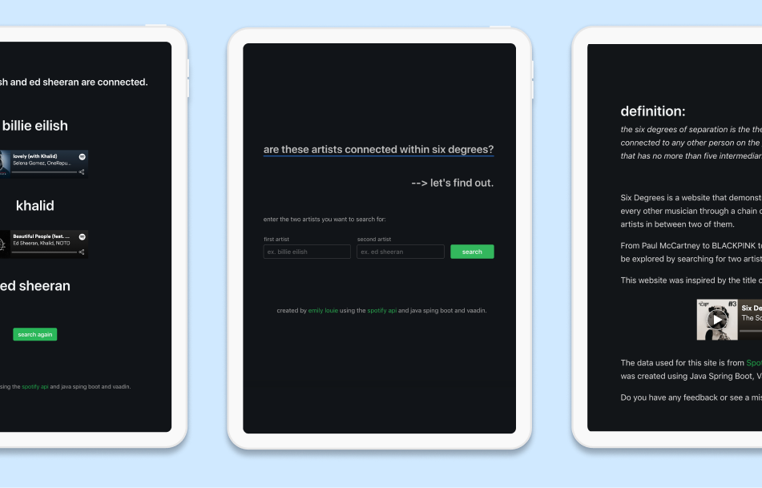
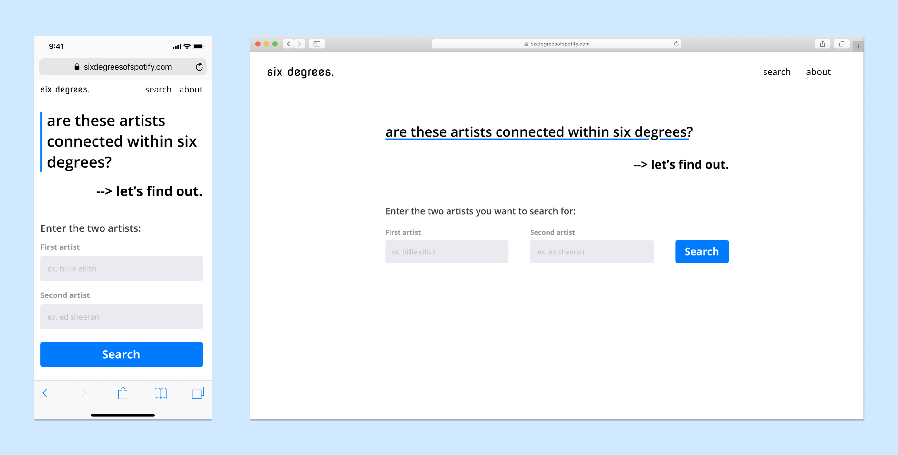
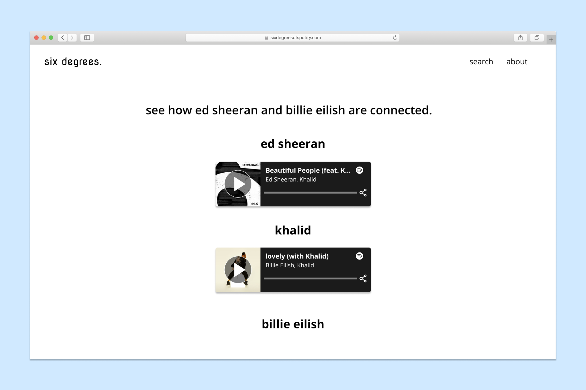
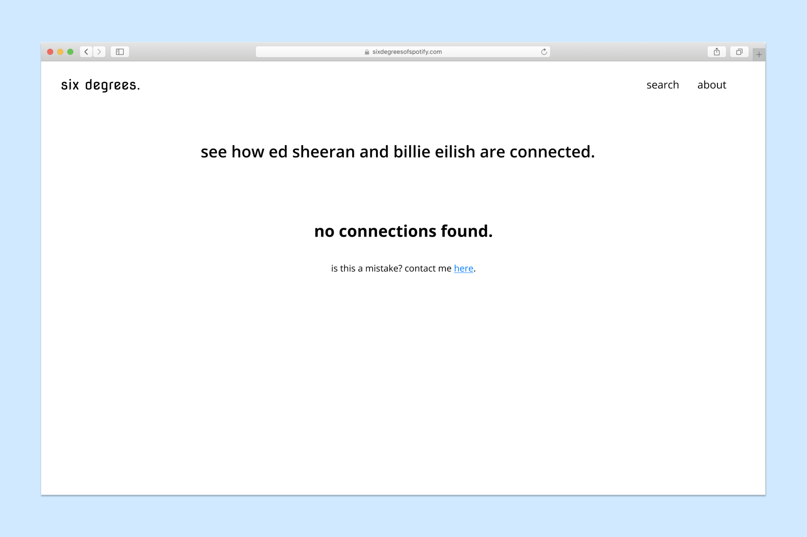
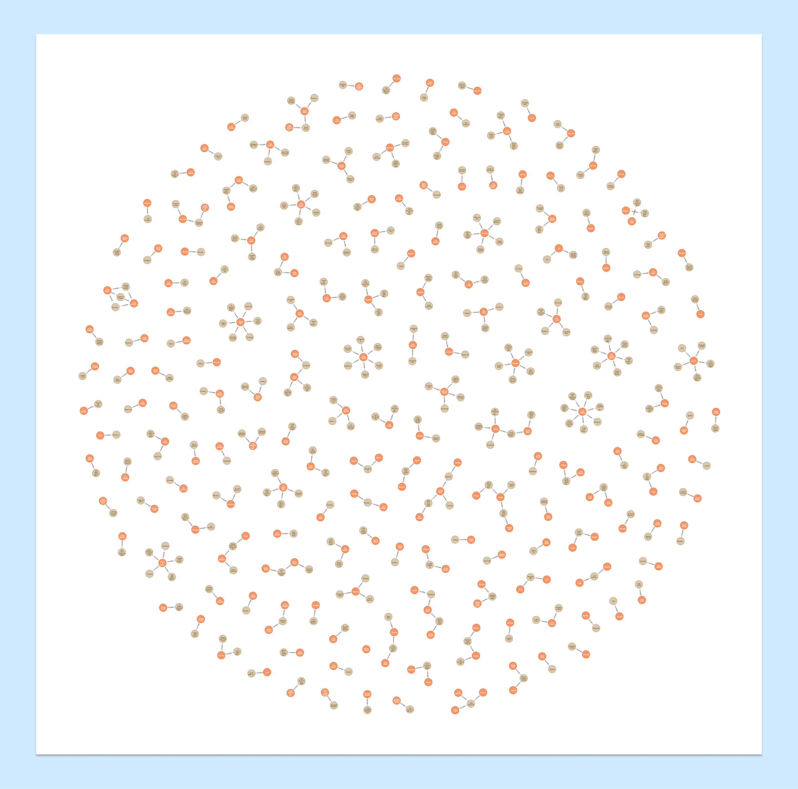
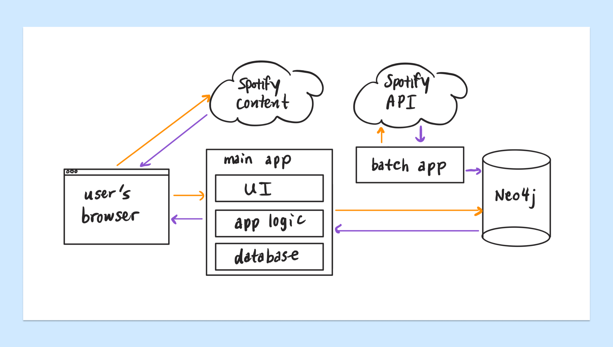
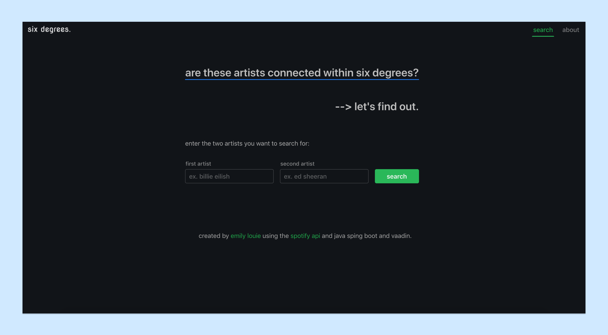
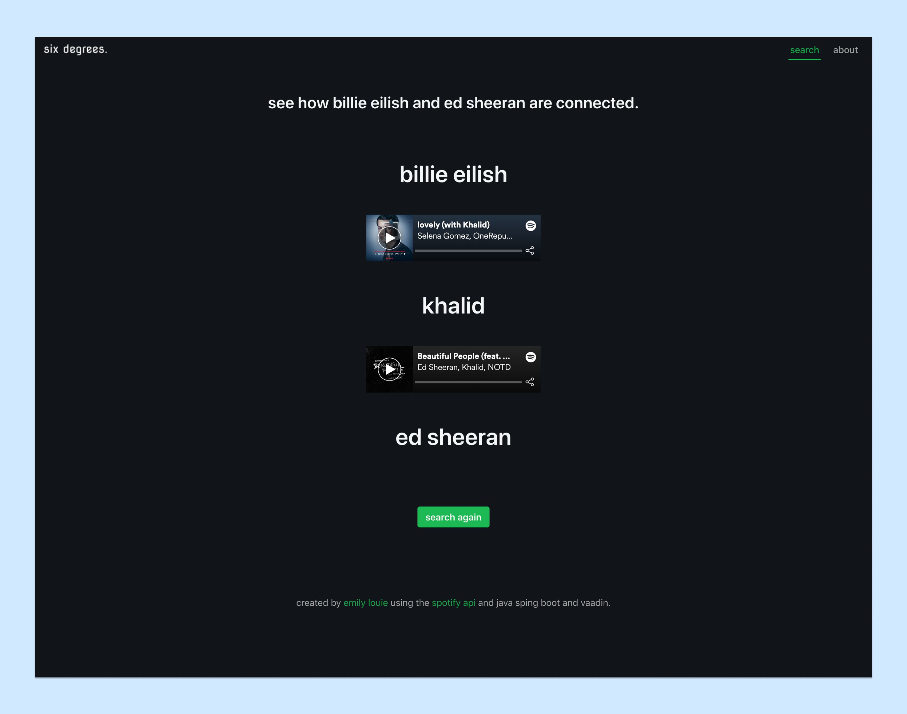
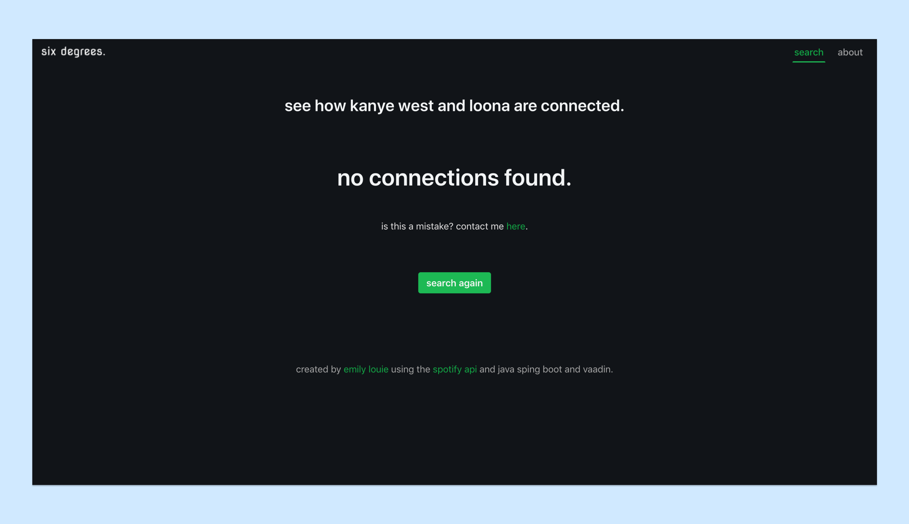
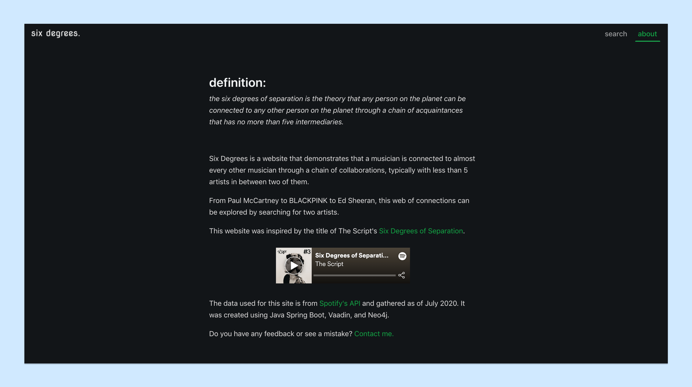

import { Link, graphql } from "gatsby"
import { DetailsProject, Blockquote } from "../components/details.js"
import { AnchorLink } from "gatsby-plugin-anchor-links"
import MoreProjects from "../components/moreProjects.js"

<div className="header">
  <h1 className="purple">{props.pageContext.frontmatter.shortTitle}</h1>
  <h2>{props.pageContext.frontmatter.title}</h2>
</div>

Six Degrees of Spotify is a website I created that demonstrates that the theory of <a href="https://en.wikipedia.org/wiki/Six_degrees_of_separation" className="link" target="_blank" rel="noreferrer">six degrees of separation</a> applies to the music world as well. This means that a musician is connected to almost every other musician through a chain of collaborations, typically with less than five artists between the two of them. From Paul McCartney to BLACKPINK to Ed Sheeran, this web of connections can be explored by searching for two artists, and a chain of connections with be displayed if there is a series of collaborations. I used data from <a href="https://developer.spotify.com/" className="link" target="_blank" rel="noreferrer">Spotify's API</a> which was gathered as of July 2020, and created this application using Java Spring Boot, the Vaadin UI framework, and a Neo4j graph database.

<DetailsProject
  role={props.pageContext.frontmatter.role}
  timeline={props.pageContext.frontmatter.timeline}
  skills={props.pageContext.frontmatter.tags}
/>



<div id="quickstart"></div>

#### Quickstart

## Running the project

1. Clone the <a href="https://github.com/emilyslouie/six-degrees" className="link" target="_blank" rel="noreferrer">repository</a>
2. Navigate to the project folder and run `bash> cd docker-neo4j`
3. Run `bash> docker-compose up -d` to start the Neo4j database
4. Start the application by running `bash> java -jar spotify-ui/target/spotify-ui-0.0.1-SNAPSHOT.jar`
5. Visit your localhost and search for two artist to try it out!
6. When you are done, run `bash> docker-compose down` to stop the Neo4j database and close your browser

<br />
<AnchorLink to="/sixdegrees#solution" title="Solution" className="link">
  Jump to the final result.
</AnchorLink>

## Why is it not live?

Unfortunately, the Neo4j database I am using requires too many resources to run properly using free services. I am currently looking for a solution and hope to find an easy way to run it on the web.

#### Context

## Inspiration

<Blockquote text="The six degrees of separation is the theory that any person on the planet can be connected to any other person on the planet through a chain of acquaintances that has no more than five intermediaries." />

<a
  href="https://whatis.techtarget.com/definition/six-degrees-of-separation"
  className="link"
  target="_blank"
  rel="noreferrer"
>
  (Source)
</a>
<br />
<br />

<div className="row">
  <div className="column">
    <p>
      Listening to{" "}
      <a
        href="https://open.spotify.com/track/0Sayb1EWTywPttwJo7zjBt?si=P14dbX1aQYa5b4QtW3V9gA"
        className="link"
        target="_blank"
        rel="noreferrer"
      >
        Six Degrees of Separation
      </a>{" "}
      by The Script (one of my favourite bands now) for the first time reminded
      me of the above theory of the six degrees of separation. While this theory
      has been disproven, I was interested in seeing if this theory would
      continue to be disproven in the music industry.
    </p>
    <p>
      Thus, I began to explore the use of the Spotify API which allows me to
      easily access thousands and thousands of artists and their songs. With
      this much data, I am able to draw those connections with some code and
      present it in an interesting way.
    </p>
  </div>
  <div className="column middle">
    <iframe
      src="https://open.spotify.com/embed/track/0Sayb1EWTywPttwJo7zjBt"
      width="300"
      height="350"
      frameborder="0"
      allowtransparency="true"
      allow="encrypted-media"
    ></iframe>
  </div>
</div>

A similar concept has also been done by Sunny Amrat's <a href="http://sixdegreesofkanyewest.com" className="link" target="_blank" rel="noreferrer">Six Degrees of Kanye West</a> <a href="https://github.com/sa2812/Six-Degrees-of-Kanye-West" className="link" target="_blank" rel="noreferrer">(Github)</a> which was built in Python and finds if an artist is within six or less collaboration songs with Kanye. I wanted to expand on this notion to create a more versatile application allowing the user to search between any two artists rather than just Kanye West and another. Thus, in terms of technicality, I knew this would be feasible since I could collect the artists from the API and map relationships between them to calculate the degrees of separation between two artists, this would just need to be a much larger database than the one Sunny used.

## Goal

<Blockquote text="How might we empower people to find the collaboration songs between their favourite artists?" />

Originally, I thought it would interesting to show a data visualization that graphs the connections between artists based on collaboration songs in a web format. However, due to how large the visualization might be, I opted for narrowing the problem:

<Blockquote text="How might we help people find the path of collaboration songs between two artists?" />

For me, this was a interesting problem to try and solve. As someone who listens to a lot of different music in different genres, I thought it would be interesting to see how the artists might be related, if at all. This also opens up some opportunities that I could explore in a future project, such as helping to create a seamless playlist between two artists even if they span across different genres.

#### Design and Development

## Creating the interface

I began with sketches of what I wanted the interface to look like. I know I wanted to make this mobile friendly, so the I opted for a more vertical layout to display the site. I also used a simple layout since I wanted the user interaction to focus on the searching of two artists to find the connections between them. Thus, I surfaced the search feature to the home page rather than the search being on a separate page. As such, I gave a brief introduction to what can be done using the website, and then two search fields with a call to action button to allow the user to immediately search.<br/><br/>



<p className="caption">
  I designed some mockups in Figma to create direction for the frontend.
</p>

With this layout, the user does not require very complex instructions as there are very few things going on, and thus a low cognitive load. It is also well-explained and intuitive to use.

After the search is made, there are a few states the user can end up in:

<div className="list">
  <h3>
    1. Both artists are found in the database, and there is a path between them
  </h3>
  <p>
    If this first scenario occurs, the user will see a vertical layout
    displaying the name of the first artist on the collaboration song, followed
    by the Spotify embed of the collboration song, and the second artist
    underneath it. This pattern continues until the second artist from the
    initial search parameter is found.
  </p>
</div>



<p className="caption">Mockup of the first scenario.</p>

<div className="list">
  <h3>
    2. Both artists are found in the database, and there is no path found
    between them
  </h3>
  <h3>3. One or both of the artists are not found in the database</h3>
  <p>
    If the second or third scenario occurs, I simplified the experience and made
    the content simply say "no connections found" to encompass both scenarios.
    This has some drawbacks since it does not explicitly indicate to the user
    why their specific search did not return any results, however, for an MVP,
    this suffices as a catch-all solution.
  </p>
</div>



<p className="caption">
  Mockup of the result from the second and third scenarios.
</p>

## Exploring technologies

Starting off, I thought I could complete the query using only a breadth first search that would stop after 7 layers. While I knew this theoretically should work, practically, it was not feasible due to the amount of time it takes to request from the Spotify API and process the results. (Trust me, I tried...)

Thus, I needed to pivot and create a more hefty application. I knew there was going to be 3 main parts of the application:

1. Pinging the Spotify API and storing the artists and their songs in a database for easy searching
2. Querying the artists requested by the user and finding the path of collaborations between them
3. Creating the user interface and handling the user's interactions

Because I wanted to further explore the use of Java and Spring, I used it as the base of my application. I have used Java for awhile and am familiar with it and Sping has many capabilities that make it easy to connect to databases and frontend frameworks.

Initially, I used PostgreSQL to store each artist and their songs with collaborators. Theoretically, using an SQL query to join the table to find the correct path between two artists should be possible. However, practically, this proved once again to not be feasible due to the amount of time it takes (~18 minutes) to successfully locate the correct path.

Instead, I chose to use a graph database, Neo4j, to store the artists and their songs. This made it easy to look up artists and find the path between them (less than a second)! Having not used a graph database before, it was a little difficult getting everything set up, but it was very cool to try out since Neo4j comes with a way to easily visualize the connections in the database.<br/><br/>



<p className="caption">
  Example of a visualization of my Neo4j database. The orange nodes represent
  musicians that "play on" the songs shown in the brown nodes. Click the image
  to see the details, perhaps you can see your favourite artist!
</p>

Also, Neo4j makes it really easy to query for the path between two artists as mentioned before. This can be done using the Cypher code snippet below and almost instantly returns a result:

```cypher
MATCH p=shortestPath((start:Artist {spotifyId:$spotifyId}-[*]-(end:Artist {spotifyId:$spotifyId2})) RETURN p)
```

<br />
<br />
After ensuring all of this worked in the console, I then began to store all of
the artists and their songs with collaborations by pinging the Spotify API.

Then, I developed the user interface using Vaadin, a Java UI framework. I had never used it before, but it was interesting to learn and made me appreciate how Vaadin makes it easy for backend developers to create frontend interfaces. It also made me appreciate frontend frameworks like React more due to the ease in customizability that it has for UIs over Vaadin.

In the end, the complete architecture of the application resulted the following structure:<br /><br />



<p className="caption">
  The structure of the overall application at a high level.
</p>

Overall, there are two parts to the application, the part involving user interaction and the batching application. The batching application calls the Spotify API and retrieves data which it adds to the Neo4j database. The user's journey begins in the browser where they will make a request that is processed by the main application. This is comprised of the UI that the user interacts with directly, the app's logic which processes the user's request, and the database level which take the requests and calls off to the Neo4j database which returns information that is surfaced back to the user's browser. The user's browser also calls Spotify content to display the embedded songs on the page.

## Challenges

One of the challenges of using the Spotify API was not the API itself, but the mass amounts of data that the Spotify API can return. Originally, I thought it would be possible to clone most, if not all, of Spotify's information on songs with collaborators, however, I quickly realized how long this process was taking and the size of my database. I underestimated the amount of items on Spotify. Thus, I chose to focus on the more popular songs only include those since that would satisfy 80% of users.

I also ran into the issue where I was using the wrong type of database to house my project. Initially, I thought a SQL database would make sense since there are queries that exist for the six-degrees-type query. However, upon trying it, performance-wise, it was unfeasible and not a good user experience. Thus, I switched to a graph database which helped make the query a lot easier and faster.

In terms of the user interface, it did not feel cohesive and was generic. Thus, I chose to change the colour palette to match Spotify's colour scheme. This included a dark mode with green accents. This helped to make my application match and correlate better with Spotify.

Lastly, I faced problems trying to host the application online for free. Needing to run my Neo4j database and serve the UI, there were not many options that had enough computing power to serve it onto the web. After trying several hosting platforms, I could not find a way to host the app for free.

<div id="solution"></div>

#### Solution

## Final result



<p className="caption">The landing page with search inputs.</p>



<p className="caption">
  The page with a successful search that returns a path between the two searched
  artists.
</p>



<p className="caption">
  The page with an unsuccessful search that returns an error message.
</p>



<p className="caption">
  The about page that describes my intentions for the site.
</p>

The final application has the ability to search for two artists and view the path between them through song collaborations if such a path exists. The code for the site is available <a href="https://github.com/emilyslouie/six-degrees"  className="link" target="_blank" rel="noreferrer">on my Github</a> to view. <AnchorLink to="/sixdegrees#quickstart" title="Quickstart" className="link">
See how to run the application.</AnchorLink>

## Future roadmap

<div className="list">
  <h3>
    1. As a user, I want to try the application without cloning the git
    repository. (discoverability)
  </h3>
  <p>
    My first prioritization is hosting the project so that I can share the
    application and have others try it out! Currently, there is no feasible way
    to host the project for free, but I will continue looking.
  </p>
  <h3>
    2. New music comes out frequently, as a user, I want to see the latest
    collaboration songs appear when I search for certain connections. (staying
    current)
  </h3>
  <p>
    My next prioritization is to ensure the database of songs and collaborations
    stays up to date since my database is only current as of July 2020. This
    ensures that when someone searches up an artist with a new collaboration
    song, the song is recognized as a linker and may help to connect two artists
    if they were not connected before.
  </p>
  <p>
    One way to do this is to automate a process once-a-week to fetch new songs
    from the Spotify API via the weekly hot playlists which often feature new
    music. This way the database stays up to date with music that 80% of people
    will search for.
  </p>
  <h3>
    3. As a user, I want to create a playlist that has smooth transitions
    between two of my favourite artists using the collaboration songs between
    them. (new feature)
  </h3>
  <p>
    Similar to{" "}
    <a
      href="http://boilthefrog.playlistmachinery.com"
      className="link"
      target="_blank"
      rel="noreferrer"
    >
      Boil the Frog
    </a>{" "}
    but using collaboration songs instead of artist similarity, this feature
    would allow the user to create a seamless playlist between two artists based
    on collaboration songs and other songs to help fill up the playlist. This
    would be relatively simple to do given the data I have collected and the
    fact that the Spotify API allows developers to create and save playlists to
    user accounts after authentication.
  </p>
  <h3>
    4. As a user, I want to see the path between the two artists I initially
    searched for, as well as see any other collaborators they may have. (new
    feature)
  </h3>
  <p>
    Similar to{" "}
    <a
      href="https://github.com/fsahin/artist-explorer"
      className="link"
      target="_blank"
      rel="noreferrer"
    >
      Spotify Artist Explorer
    </a>{" "}
    but using collaboration songs instead, this feature would allow a user to
    search for two artists, show that initial connection through collaborations,
    and then also show any other collaborations with other artists in a web
    format. This could allow for the exploration of similar artists up to 2 or 3
    degrees rather than simply a linear path. To implement this, I would likely
    use a data visualization library like d3 to simplify the process.
  </p>
</div>

<br />

#### More case studies

<MoreProjects
  projects={props.data.allMdx.edges}
  current={props.pageContext.frontmatter.order}
/>

export const pageQuery = graphql`
  query {
    allMdx(
      filter: { frontmatter: { company: { ne: null } } }
      sort: { order: ASC, fields: [frontmatter___order] }
    ) {
      edges {
        node {
          id
          frontmatter {
            title
            shortTitle
            path
            type
            order
            tags
            company
            thumbnail {
              childImageSharp {
                gatsbyImageData(
                  height: 280
                  placeholder: BLURRED
                  formats: [AUTO, WEBP]
                )
              }
            }
          }
        }
      }
    }
  }
`
