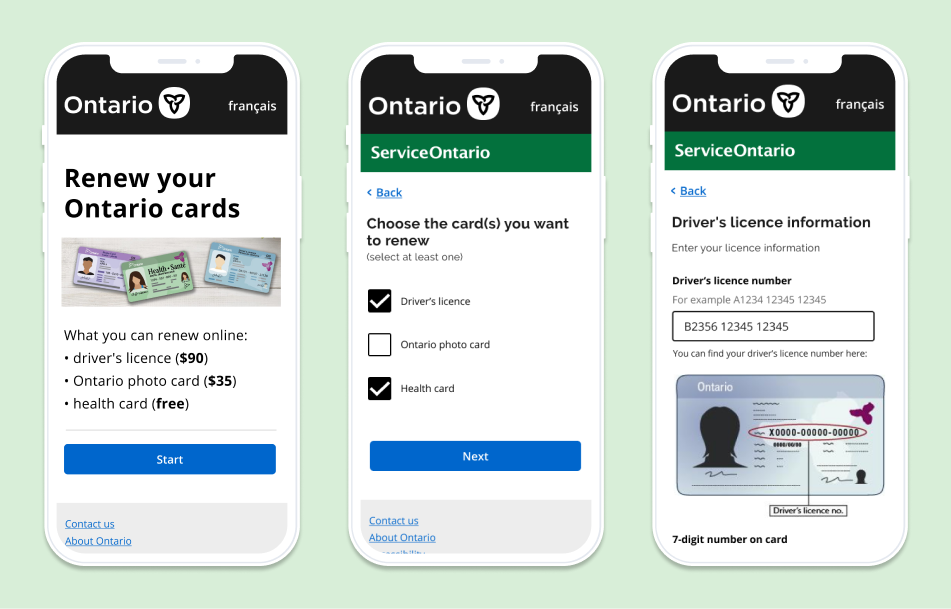
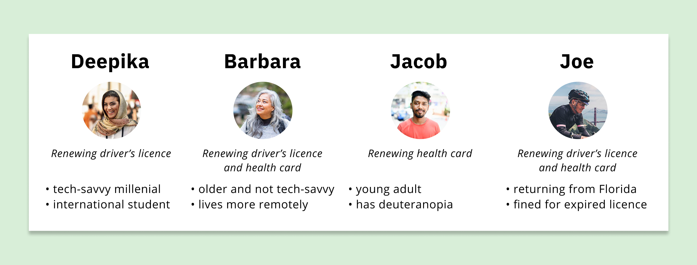
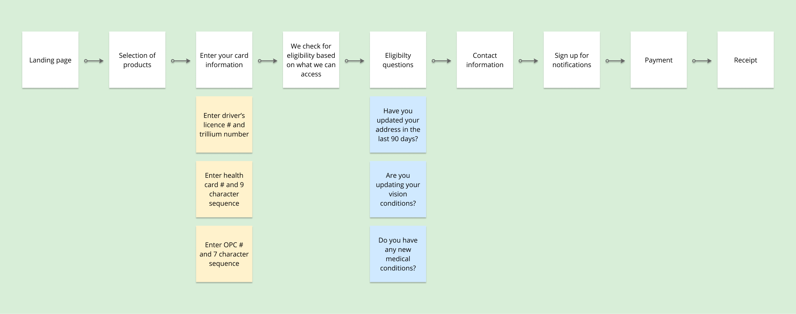
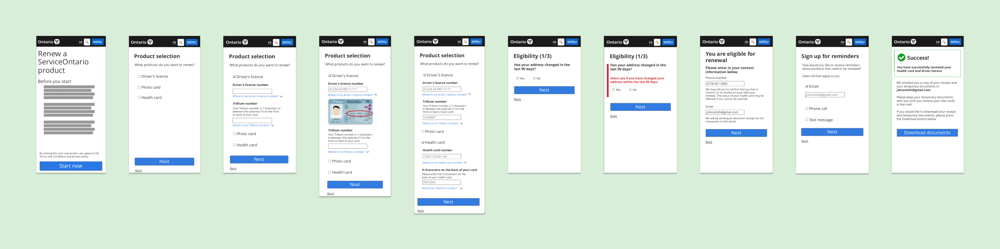
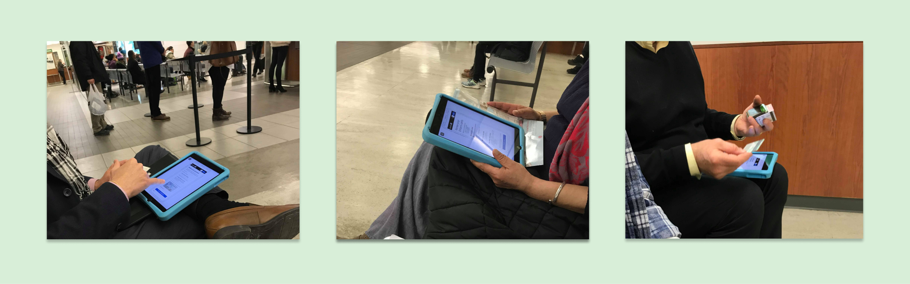
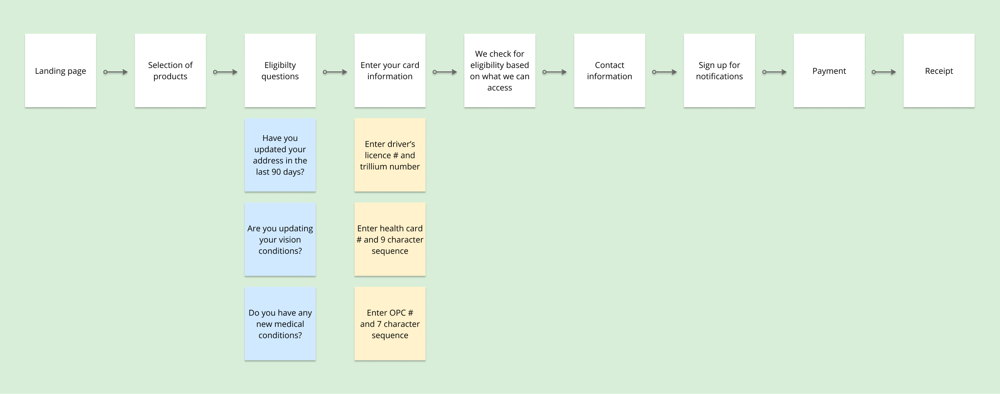
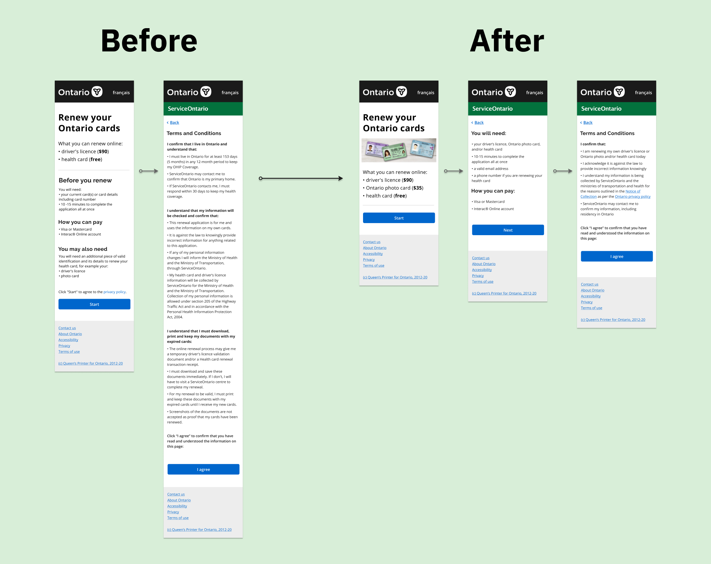
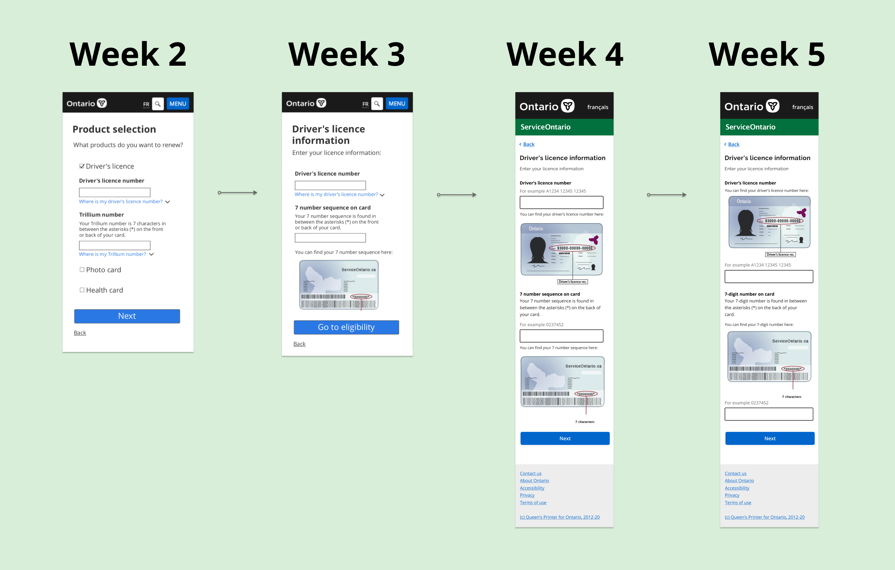

import { Link, graphql } from "gatsby"
import { AnchorLink } from "gatsby-plugin-anchor-links"
import {
  Accordion,
  AccordionItem,
  AccordionItemHeading,
  AccordionItemButton,
  AccordionItemPanel,
} from "react-accessible-accordion"
import kpi from "../images/kpi.png"
import callToAction from "../images/sorenewals/calltoactions.png"
import redundancy from "../images/sorenewals/redundancy.png"
import oneWindow from "../images/sorenewals/onewindow.png"
import simpleQuestions from "../images/sorenewals/simplequestions.png"
import errors from "../images/sorenewals/errors.png"
import error1 from "../images/sorenewals/error1.png"
import error2 from "../images/sorenewals/error2.png"
import users from "../images/sorenewals/users2.png"
import users2 from "../images/sorenewals/users3.png"
import users3 from "../images/sorenewals/users4.png"
import userJourney from "../images/sorenewals/userjourney.png"
import sketches from "../images/sorenewals/sketches.png"
import flow from "../images/sorenewals/flow.png"
import lofi from "../images/sorenewals/lofi2.png"
import system from "../images/sorenewals/system.png"
import Emily from "../images/sorenewals/emilytesting.png"
import { Details, Blockquote } from "../components/details.js"
import MoreProjects from "../components/moreProjects.js"

  <h1 className="purple">ServiceOntario Renewals</h1>
  <h2>{props.pageContext.frontmatter.title}</h2>

The province of Ontario has several identification cards such as driver's licences, health cards, and photo cards which require renewals every few years. As a product design intern at the Ontario Digital Service, a division of the Government of Ontario, I worked with my team to redesign the web platform used by 5 million people annually to ensure it is logical and accessible, as well as increase overall completion rates.

#### Context

## Problem

There currently is a online renewal platform for some of the identification cards issued by the province which was created to be an efficient alternative to the long, dreaded waits associated with the in-person process. However, analytics have shown that the process's completion rates are less than satisfactory and sentiment from the public is mediocre at best especially regarding accessibility. This is because people run into processing errors while using the online service which force them to complete the transaction in person. These issues are summarized by the following:

  <h3>1. Low transaction completion rates</h3>
  <h3>2. Negative sentiment surrounding the platform and process</h3>
  <h3>3. Accessibility issues using the platform</h3>

## Breaking down the goal

To further understand the frustrations that Ontarians were having with the platform, our team analyzed over 1,500 comments submitted through the current service's feedback form. The main pain points and opportunities to improve them were:

  <h3>
    1. It was difficult finding the correct service to renew their products.
  </h3>
  

    <strong className="purple">Opportunity: </strong>Combine the standalone
    services into a single renewal service.
  

  <h3>
    2. Ontarians were confused by the questions being asked and the redundancy
    of information being asked of them.
  </h3>
  

    <strong className="purple">Opportunity: </strong>Simplify the content, and
    only ask what is necessary.
  

  <h3>
    3. When running into an error that prevents them from continuing the
    process, Ontarians could not figure out why, nor what to do next.
  </h3>
  

    <strong className="purple">Opportunity: </strong>Thoroughly explain error
    states and suggest next steps to rectify the situation.
  

<Accordion allowZeroExpanded>
  <AccordionItem>
    <AccordionItemHeading>
      <AccordionItemButton>
        Learn more about the pain points
      </AccordionItemButton>
    </AccordionItemHeading>
    <AccordionItemPanel>
      <h3>1. Discoverability and correct platform</h3>
      

        A notable number of feedback responses by Ontarians cited the inability
        to renew their identification due to not being able to find the service
        that renews for their specific case.
      

      

        Currently, Ontario has two platforms to renew ServiceOntario products.
        This includes the{" "}
        <a
          className="link"
          href="https://www.services.gov.on.ca/wps85/portal/s2i/!ut/p/z1/hZDLasMwEEW_pQsvpdHIsix15xYamkIfhDaxNkZ2VNvgSEFxYvL3deiq0JBZzePee2DAwAaMt6e-tWMfvB3muTSyUgsmeSHwlS0R2cfLs5IPnxl_YwhfsL4lMfOZXamCzX5zS1LOiPwqYpHC6pJRtRZKTlFnKWdSCYqYS6FSrSVFyXKFHLOcIGohhMryjGKmU-Sac37xD9a3UDoPK-erxwKWYNoh1L9fKHydqhZMdN8uukiPcV5347g_3CcsYdM00eBHG_tAG5uwvW1dwqLzbiJ1GDtyDsdIOmeHuW9s3BLrt2Qb-5OLBzL0jfONI8EPvXf_4bpwGGHzlwL73ZN-3-1UKkx9noq7H7_yT1w!/dz/d5/L2dBISEvZ0FBIS9nQSEh/"
          target="_blank"
          rel="noreferrer"
        >
          standalone driver's licence renewal
        </a>{" "}
        and the{" "}
        <a
          className="link"
          href="https://www.services.gov.on.ca/wps85/portal/s2i/!ut/p/z1/hZDLTsMwEEW_hUWW9owd52F2EeIhFtCqFBpvIicdkkipXblpo_49qVghUXVW87j3HmnAwAaMs6e-tWPvnR3muTRplT9jKgsl3t4_1hqXCb6I5SKL8RHhE75uScx8xitV4Ow3tyTljMiuItYIq0tG1VooJZexEhpRciGyVOWx1ikXKWa5kCLJmBBaKZUnWcJFomMhtZTyYh-sa6EkByty1UMBr2Dawde_TyhcHectmEDfFCjwY5jX3TjuD_cRRjhNE_dutKH3vLER7m1LEQZyNLHajx07-2NgHdlh7hsbtsy6LduG_kThwIa-IdcQ827oHf2H6_xhhM1fCux3T3qx2-WxMvV5Ku5-APOlIF0!/dz/d5/L2dBISEvZ0FBIS9nQSEh/"
          target="_blank"
          rel="noreferrer"
        >
          integrated driver's licence and health card renewal
        </a>{" "}
        platforms. While it may seem easy enough since there are only two
        platforms, one of the main issues lies in the labelling of these
        platforms when they are discovered.
      

      

        Ontario has a series of information pages that explain their products
        which is also explains how to renew these products. These pages are
        often the place Ontarians will go to find the ultimate online renewal
        platforms which is a problem because of how some of the call-to-action
        buttons are labelled.
      

      

        

          
          

            The call to actions and page headings were different, causing users
            to find the incorrect service for their needs.
          

        

        

          

            For example, on this page, the user is looking to only "renew your
            driver's licence" as indicated by the main heading. However, the
            call to action shows that you can renew your driver's licence or
            health card. Firstly, this is confusing as it takes you to a
            platform where you need both of these products in order to renew
            successfully, and users may not have both in every situation.
          

        

      

      

        Secondly, there is a another renewal platform that supports the renewal
        of only a driver's licence, why not link them there instead? Lastly,
        there is a separate page talking about renewing both a driver's licence
        and a health card at the same time, so the call to action on the "renew
        a driver's licence" page would be better.
      

      

        Thus, there is an opportunity to improve the discoverability and linking
        to these platforms through consistent call to actions. Taking this a
        step further, combining all these services into one makes it so that it
        is impossible to find the "incorrect" service, helping to address this
        prominent concern from users.
      

       
      <h3>2. Redundant and confusing questions</h3>
      

        

          

            Analyzing the feedback from Ontarians also raised the question as to
            why our platform asks for the same information more than once from
            our users, as well as why the language being used is so complicated
            to understand.
          

          

            For example, the user is asked for address information in the second
            step, and then also asked again for their postal code in the third
            step. This causes duplicate entries of information, making users ask
            why they needed to do that twice.
          

        

        

          
          

            The questions were repeated and confusing to users.
          

        

      

      
Also, there were questions with convoluted language such as:

      <Blockquote text="Do you suffer from, or has a physician ever advised you that you suffer from any medical condition (including, but not limited to, heart disease, stroke, diabetes requiring insulin to control, epilepsy, seizure disorder, or any condition that may result in loss of consciousness or awareness) or any physical disability or functional impairment that may affect your safe operation of a motorized vehicle?" />
      

        For me, although I read the sentence more than once, it was still
        difficult to understand what it is trying to ask since it seems to ask
        three questions in one long blurb. It is questions like these that users
        seemed to stumble on and possibly answer incorrectly.
      

      

        While I understand that some of questions are asked for verification reasons by the Ministry of Health to prevent fraud, I strongly believe that many of the questions are unnecessary or could be improved upon to make it easier for the common person to renew.
      

      

        As such, there is opportunity to improve by removing duplicate questions, and simplifying the content to be more understood by the general population.
      

       
      <h3>3. Errors missing valid explanations</h3>
      

        Ultimately, the errors that were provided to users when they encountered
        a barrier preventing them from completing the transaction online was the
        area with the most room for improvement.
      

      

        Below are three different error messages that appear at different points in time depending on when the user encounters an error and for what reason. All three of them have a few similar traits:
        <ul>
          <li>
            Lack of a core reason as to why a user cannot complete the transaction online
          </li>
          <li>
            Repeated verbiage that does not fit the user's unique situation
          </li>
          <li>
            Vague next steps when asked to "visit your nearest ServiceOntario centre"
          </li>
        </ul>
      

       
      
      

        The errors shown were vague, providing little context as to why they
        cannot complete the transaction online and cited often in the responses
        to the feedback form. I believe that the
      

      

        This provides an opportunity in the redesign to integrate clearer reasons for error that do not blanket all users, as well as provide more direct next steps for the in-person renewal process.
      

    </AccordionItemPanel>

  </AccordionItem>
</Accordion>

These findings presented the opportunity to explore the following refined problem statement and goal for our solution:

<Blockquote text="How might we redesign the online renewal platform to be a one-window transaction flow that promotes usability and inclusion?" />

We will know when the goal has been met with the following key performance indicators:

  

    
    <h3>Reduce time spent on task</h3>
  

  

    
    <h3>Increase transaction completion rates</h3>
  

  

    
    <h3>Increase in positive feedback and overall sentiment</h3>
  

While the in-person process for ServiceOntario renewals is also important, the scope of the project was limited to refining the online platform. However, to create a holistic solution, we considered the end-to-end service to ensure our online redesign is logical and easy to implement with consideration to the in-person service.

## Our approach

  

    

      <h3 className="purple">1.</h3>
    

    

      <h3 className="purple">Research</h3>
      
Analyze user feedback

      
Site audit

      
Personas

      
Journey mapping

      
Empathy mapping

    

  

  

    

      <h3 className="purple">2.</h3>
    

    

      <h3 className="purple">Design</h3>
      
User flows

      
Low-fi prototypes

      
Hi-fi designs

      
Interactive prototype

      
Coded prototype

    

  

  

    

      <h3 className="purple">3.</h3>
    

    

      <h3 className="purple">Evaluate</h3>
      
User testing

      
Design iterations

      
Reflection

    

  

Each week, we followed the process of plan, design, and test for six weeks. With this approach, we redesigned the existing web platforms into one consolidated service that allows users to renew all of their ServiceOntario products at once. It also streamlines the process, helping users "fail faster" and understand why there are errors if any arise. <AnchorLink to="/sorenewals#solution" title="Solution" className="link">
Jump to the solution.</AnchorLink>

#### Research

## Understanding the user journey

First, I familiarized myself with the current platform and process for renewing one's driver's licence and health card. I completed a site audit to trace the different entry points, only to find that many entry points had contradicting call-to-actions that led to an unexpected service. For the final design, we made sure to include fewer, as well as consistent entry points to the platform.

By going through the process myself, I encountered each of the pain points users faced when using the platform. It really showed me how difficult the service was to use, and how people who have more barriers than I do will not be able to use the service to its full extent.

Next, we created four personas to see how diverse our target audience is. These were informed by analyzing the feedback received on the current platform. This process also included individual journey maps, empathy maps, and an overall, consolidated user journey map which outlines the design of the entire service.   

  My team and I created four main personas to better understand our users and
  their needs for the platform.

<Accordion allowZeroExpanded>
  <AccordionItem>
    <AccordionItemHeading>
      <AccordionItemButton>
        Learn more about the user research we did
      </AccordionItemButton>
    </AccordionItemHeading>
    <AccordionItemPanel>
      

        The user personas helped us understand different groups of Ontarians
        through their backgrounds and situations, as well as their goals. This
        helped us get into heads and understand their{" "}
        <a
          href="https://uxdesign.cc/8-things-to-use-in-jobs-to-be-done-framework-for-product-development-4ae7c6f3c30b"
          className="link"
          target="_blank"
          rel="noreferrer"
        >
          jobs to be done
        </a>
        .
      

      

        This helped me understand what our personas had to do to complete their
        ultimate goal of renewing their ServiceOntario products. There are three
        major steps that can occur:
      

      

        <h3>1. Receiving notification to renew their products.</h3>
        <h3>2. Attempt to renew their products online.</h3>
        <h3>
          3. If unsuccessful at step 2, then visit an in-person ServiceOntario
          location.
        </h3>
      

      

        For each of these steps, we looked into the possible scenarios and
        intricacies of the persona's individual situation. I analyzed the
        actions at each step and looked for opportunities to improve upon it.
        This resulted in four individual user journeys.
      

      
      

        Each persona warranted an individual user journey.{" "}
        <a
          href="https://miro.com/app/board/o9J_kuedVQ8=/"
          className="link"
          target="_blank"
          rel="noreferrer"
        >
          See it in detail.
        </a>
      

      

        From completing this exercise, we also were able to connect with the
        personas and understand the existing user journey from their
        perspective. This resulted in creating four empathy maps that lay out
        what our personas would see, hear, feel, and be frustrated with about
        the current platform.
      

       
      
      

        We created an empathy map for each user persona.{" "}
        <a
          href="https://miro.com/app/board/o9J_kuedVW8=/"
          className="link"
          target="_blank"
          rel="noreferrer"
        >
          See it in detail.
        </a>
      

      

        We summarized the findings from each of these personas into a very
        comprehensive, overall user journey. This showed us the entire service
        and all components from the moment you get a reminder to renew your
        product to finishing a renewal in-person.
      

       
      
      

        The overall user journey map gave us an idea of the entire service.
      

      

        Afterwards, we looked at other governmental organizations to see how
        they offer their renewal services. This gave us an idea of how they may
        or may not have made their platform easy for their users, allowing us to
        implement parts of these ideas into our own service.
      

       
      <iframe
        src="https://airtable.com/shrmJFfYnVN0tZPcH/tblxgsiVAIN7Ehsax?backgroundColor=purple&layout=card"
        frameborder="0"
        width="100%"
        height="450"
      ></iframe>
      

        We analyzed different platforms for interesting features.{" "}
        <a
          href="https://airtable.com/shrmJFfYnVN0tZPcH/tblxgsiVAIN7Ehsax?backgroundColor=purple&layout=card"
          className="link"
          target="_blank"
          rel="noreferrer"
        >
          Explore the AirTable here.
        </a>
      

    </AccordionItemPanel>
  </AccordionItem>
</Accordion>

  From this process, I learned to think systematically about the problem at
  hand, and ensure I take into account the entire design of the service from the
  digital platform to the in-person renewal process.{" "}

#### Design

## Prototyping the golden path

By understanding the user journey of the current platform, it made crafting the new user flow easier since the specific pain points are already identified.

We explored a one-window approach that consolidates all of the current services. It removes the confusion when Ontarians currently face when trying to find the correct service to renew their product, and allows them to renew everything at once rather than having to complete more than one transaction.

From here, we focused on developing a high level flow chart to take advantage of common design patterns to make the transaction process familiar and easy. Logically, it made sense to keep the platform similar to a wizard-like form and use the card information as a login-type credential to check eligibility right away.  

A high level overview of the user flow.

While prototyping, we made sure to take a mobile-first approach to allow for scalability. For the first week, we started with Balsamiq to map the golden path (putting error states on hold) of renewing both a driver’s licence and health card at the same time. During week two, we added the ability to renew driver’s licences and health cards individually.  

  We created low fidelity mockups to test user flow and information
  architecture.{" "}

<Accordion allowZeroExpanded>
  <AccordionItem>
    <AccordionItemHeading>
      <AccordionItemButton>
        See more wireframes and progress photos
      </AccordionItemButton>
    </AccordionItemHeading>
    <AccordionItemPanel>
      
      

        One of the sketches I did the get a sense of the flow and basic
        interface.
      

      
      

        As a team, we mapped all the possible paths to help with creating a
        solid logic flow.
      

      
      

        After creating and user testing low fidelity mockups in Balsamiq, we
        identified satisfied and unsatisfied parts of the platform each week.
      

      
      

        When moving to higher fidelity, we created a variation of the{" "}
        <a
          href="https://designsystem.ontario.ca"
          className="link"
          target="_blank"
          rel="noreferrer"
        >
          Ontario design system
        </a>{" "}
        at the time to help make prototyping more efficient.
      

    </AccordionItemPanel>
  </AccordionItem>
</Accordion>

In week three, we migrated to Figma and worked on guiding Ontarians when they deviated from the golden path. In the final week, we tested a coded prototype that included the option to renew Ontario photo cards and error states, too.  

<iframe
  style="border: 1px solid rgba(0, 0, 0, 0.1);"
  width="100%"
  height="450"
  src="https://www.figma.com/embed?embed_host=share&url=https%3A%2F%2Fwww.figma.com%2Ffile%2FQjWeJZjwAGUw9MefKOHhsA%2FSO-Renewals-Website-Copy%3Fnode-id%3D718%253A23227"
  allowfullscreen
></iframe>

  In the end, we had over 256 artboards in total for all of the possible paths!

It was really important for us to include the ability to renew an Ontario photo card in this renewal service. This is because the Ontario photo card was initially created to help 1.5 million Ontarians access and obtain a valid form of identification since they do not have a driver's licence. Currently, there is no online service to renew this product – thus, a product meant to be accessible and have similar privileges as a driver's licence, truly is not meeting its initial goal. By including it in this prototype, we are advocating for its inclusion in the next iteration of the renewal platform.

#### Evaluate

## User testing at the busiest ServiceOntario

Each week, we took what we were working on and tested it with Ontarians at the busiest ServiceOntario location in Toronto. We asked individuals who were renewing their driver’s licences, health cards, or both, to try out our redesigned platform. For the first two weeks, we tested with a Balsamiq prototype, while in the last two weeks, we used a combination of the Figma prototype and the coded website. In total, I led 11 guerilla tests with Ontarians.  

We tested with real Ontarians every week.

<Accordion allowZeroExpanded>
  <AccordionItem>
    <AccordionItemHeading>
      <AccordionItemButton>
        Learn more about my experience guerilla testing
      </AccordionItemButton>
    </AccordionItemHeading>
    <AccordionItemPanel>
      

        As an introvert, user testing was not in my comfort zone, let alone
        guerilla user testing. The thought of approaching a stranger and asking
        them to try out our application when there is a chance that they might
        not like it was terrifying to me. I got nervous from just watching my
        colleagues conduct the interviews.
      

      

        For the first one that I conducted on my own, I stumbled and stuttered
        at the beginning. However, after showing the prototype and having them
        walk me through their thoughts on it, I had calmed down, learned to
        listen intently, and started asking inquisitive questions. Ultimately,
        while it was scary at first, I quickly learned that it was not as bad as
        my mind was making it out to be.After conducting a few on my own, I
        graduated to helping others also conduct guerilla testing.
      

      

        I found it an enlightening experience as we got to survey a lot of
        different people in a really short period of time. The results were
        interesting too, as we got a lot of diverse and helpful feedback to help
        us iterate on the prototype.
      

      

        I am thankful for getting the opportunity to try guerilla user testing
        and even conduct numerous sessions myself. I hope to continue using this
        technique in the future as it is a great way to get a variety of
        feedback quickly.
      

    </AccordionItemPanel>
  </AccordionItem>
</Accordion>

In the earlier weeks, from testing, I learned the following:

  <h3>1. People wanted a brief overview of what to expect from the process.</h3>
  <h3>
    2. They were sometimes confused by the language that was being used, leaving
    them puzzled about what they needed to do.
  </h3>
  <h3>
    3. When encountering errors, Ontarians needed more explanation and next
    steps.
  </h3>

Hearing these concerns, it felt like we were back at square one with our initial problem. But after each session, the team got together to make changes and implement the feedback we had heard. Eventually, we validated our changes in the following guerilla user testing sessions.

One of the most notable changes we made was in our third week when we noticed Ontarians were getting frustrated when faced with an error late in the renewal process. I realized that we could help them “fail faster” so they can learn more quickly that they do not qualify for renewing online and not their waste time. We reversed part of our flow so the eligibility questions are earlier in the process rather than the end.  

  We revised the user flow to help Ontarians "fail faster" after our third week
  of testing.

<Accordion allowZeroExpanded>
  <AccordionItem>
    <AccordionItemHeading>
      <AccordionItemButton>
        Learn more about why we revised the user flow
      </AccordionItemButton>
    </AccordionItemHeading>
    <AccordionItemPanel>
      

        Our initial thought was to use the card identification numbers as a
        login credential so that if users fail at this step, then they do not
        have to worry about answering questions afterwards.
      

      

        However, after testing, we realized that inputting the card
        identification numbers was the most difficult step of the process and
        most time consuming as well. Having this step right at the beginning led
        to disappointment when users did not select eligible answers after
        completing this step and were unable to complete the process.
      
 
      
      

        After week three of user testing, we plotted the user's satisfaction along the user journey. <a href="https://www.figma.com/file/U3R247geW3ObC4LkpsJNXn/SO-Renewals-%E2%80%93-User-journey-after-week-3?node-id=0%3A1"  className="link"
          target="_blank"
          rel="noreferrer">See it at full size.</a>
      

      

        Thus, we reversed the user flow so that the yes or no questions act as
        a quick eligibility check before getting to the more time consuming steps, essentially helping Ontarians "fail faster" and course correct to the path they need to be on. This allowed for those who would fail on the short questions to quickly learn that they cannot complete the process online and not waste time by getting stopped after completing longer steps.
      

    </AccordionItemPanel>

  </AccordionItem>
</Accordion>

## Implementing the feedback

In our final sprint, we reflected on everything we learned, made changes based on user feedback, and finalized the loose ends.

An important change we made included working with the constraints of a vertical layout such as a mobile phone. We found Ontarians would stop scrolling and get lost during the process, resulting in us modifying the layout so that the most important information and call to action buttons are displayed first or more prominently on the screen. This involved breaking up sections into shorter pages, and rearranging elements on the page.

We worked on breaking down the onboarding of the application into the bite sized pieces. As everyone knows and as Ontarians that we tested reiterated:

<Blockquote text="“Nobody reads the terms and conditions.”" />

But as a government service, it is important for the user to understand all parts of the process and know what they are signing up for. So, I broke down what used to a long, two screen onboarding process into three screens that end above the fold.

The concept of "the shorter the better" did not only apply to the onboarding flow, but throughout the application as well. A notable change for our application was taking our really long pages and separating it into several short pages. This helps with the mindset of one goal per page. For example, previously, we asked for users to select each of the products they wanted renew and to enter those product ids as well. Not only did this help with orienting the user to address one goal at a time, but it also make error states a lot cleaner and easier to implement on the backend.  

  We revised the onboarding screens to caputre Ontarians' attention and deliver
  important information.

To help Ontarians further understand the process, we looked at revamping the copy and microcopy to be more instructional and personal. We worked with a content designer to include more directional words that instruct the user how to complete the transaction. This also involved using pictures to aid people in completing the renewal easily.

At first, we thought hiding the pictures in dropdowns would be accessible if needed and help to keep the page fairly short. However, when looking for their card numbers, we noticed users missing these dropdowns even though they were clearly labelled. While it may seem bizarre to us, this is a prime example of demonstrating that we, as creators, have too much context and are unable to initially see problems from the user's perspective. Thus, we embedded the image with instructions for the more confusing card number directly on the form below the input field.

With more testing, we realized this still was not enough, and removed the dropdowns for all the images, making the page longer but more directly accessible for users to understand. In the final sprint, we found showing the images first even before the input field helped provide even more context and priming for users. This progression is seen in the image below.  

  We refined the content and included visuals to aid Ontarians.

In particular, the visuals were immensely helpful in making our platform easy to use and navigate the instructions. As users said:

<Blockquote text="“Pictures are worth a thousand words”" />

We also thought more about errors and the different barriers Ontarians may
encounter when trying to renew their products. This includes both human
errors, as well as technical errors that Ontarians may encounter throughout
the process. Refining these states required work in both content and
information flow, and would need more thought before shipping the final
product.

#### Solution

## Final designs

<iframe
  style="border: 1px solid rgba(0, 0, 0, 0.1);"
  width="100%"
  height="600"
  src="https://www.figma.com/embed?embed_host=share&url=https%3A%2F%2Fwww.figma.com%2Fproto%2FQjWeJZjwAGUw9MefKOHhsA%2FSO-Renewals-Website-Copy%3Fnode-id%3D718%253A29111%26viewport%3D519%252C114%252C0.032359443604946136%26scaling%3Dcontain"
  allowfullscreen
></iframe>

  The final designs were created in Figma.{" "}
  <a href="https://sorenewals.firebaseapp.com" target="_blank" rel="noreferrer">
    See the coded prototype.
  </a>

  

    <h3>Consolidated the many renewal platforms into a single service</h3>
    

      We combined the major ServiceOntario products that need renewals into one
      platform, making it easy to renew everything at once. This makes the
      single service easier to find rather than Ontarians having to find the
      specific service to renew their single or combination of products. This is
      an proof of concept, and ideally other products that also need renewals
      will be included in the final version.
    

  

  

    
  

  

    
  

  

    <h3>Simplified content and removed redundant questions</h3>
    

      Rather than asking convoluted questions like "Have you moved or changed
      your address in the last 90 days?", we have used simpler questions that
      are easy to understand like "Do you currently live at the address on your
      driver’s licence?". We also now only ask users for their information once
      rather than requiring them to enter it multiple times.
    

  

  

    <h3>Clarified errors and indicated next steps</h3>
    

      Originally, not only were the errors confusing, but there were no
      directions for Ontarians on what to do after encountering an error. Now,
      we show errors inline for validation checks, and clearly outline why a
      user may be unable to continue the process online and actionable steps to
      finish their transaction in-person.
    

  

  

    

      

        
      

      

        
      

    

  

## Results

This work was a proof of concept done to help address one of Ontario's top ten online transactions. We pitched and presented our designs and findings to both executives and Ministry partners, receiving praise for the usability and improvements compared to the existing platform.

When testing our prototype in the last week, we found that the prototype addressed all of our KPIs and exceeded our expectations. The final metrics include:

  

    
    <h3>Reduced time spent on task by approximately 42%</h3>
  

  

    
    <h3>
      90% of Ontarians would try the online renewal service before going
      in-person
    </h3>
  

  

    
    <h3>Exceedingly positive feedback from Ontarians on the user experience</h3>
  

Overall, I believe our redesign was successful and creates a better user experience for Ontarians when they are renewing their government identification cards.

## Next steps

One of the most time-consuming steps of the renewal process is typing the card number into the field. Although our redesign was able to mitigate confusion as to where the numbers are located on the card, the manual process of typing each number and letter is not ideal.

A possible short term solution is to implement a photo scanning feature that would allow the user to point their camera at the card and automatically pick up the characters. However, this does not work well with mediums such as computers which may not have a camera. Instead, a more sustainable option is to implement the concept of <a href="https://news.ontario.ca/en/backgrounder/58873/ontario-onwards-digital-identity-project"
    target="_blank"
    rel="noreferrer" className="link">digital identity</a>
which could allow renewals with the click of a single button.

Regarding the pitched redesigns, as of November 2020, work has been done to revise some of the content to use simpler language on the existing platform. While it is a good step in the right direction, unfortunately, there is no guarantee that other parts of our proof of concept redesign will be implemented in the near future.

## Reflecting back

  

    
    

      This outside of the ServiceOntario where we conducted usability testing!
    

  

  

    

      I completed a lot in such a short period of time, especially for a project
      that impacts many, many people. It was my first time completing a project
      at this scale and impact – it was the first project of my first co-op term
      as well!
    

    

      Having never done guerilla user testing before, I was extremely nervous
      the first time I was told to approach a stranger and ask for feedback.
      However, soon, I realized that these conversations helped me see the
      tangible fruits of how I am striving towards my goal of using technology
      to help people. I used this as a chance to overcome my anxieties when
      approaching and conducting user interviews with others.
    

    

      Overall, I am proud of the work we have done and I hope to continue
      working on impactful projects in the future.
    

  

 

#### More case studies

<MoreProjects
  projects={props.data.allMdx.edges}
  current={props.pageContext.frontmatter.order}
/>

export const pageQuery = graphql`
  query {
    allMdx(
      filter: { frontmatter: { company: { ne: null } } }
      sort: { order: ASC, fields: [frontmatter___order] }
    ) {
      edges {
        node {
          id
          frontmatter {
            title
            shortTitle
            path
            type
            order
            tags
            company
            thumbnail {
              childImageSharp {
                gatsbyImageData(
                  height: 280
                  placeholder: BLURRED
                  formats: [AUTO, WEBP]
                )
              }
            }
          }
        }
      }
    }
  }
`
