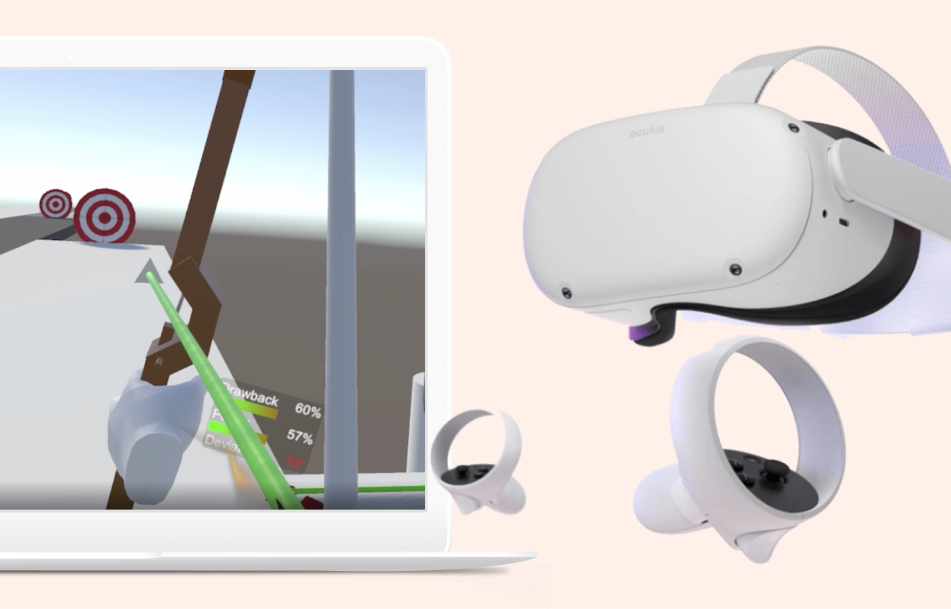

import { Link, graphql } from "gatsby"
import { DetailsProject, Blockquote } from "../components/details.js"
import { AnchorLink } from "gatsby-plugin-anchor-links"
import MoreProjects from "../components/moreProjects.js"

  <h1 className="purple">{props.pageContext.frontmatter.shortTitle}</h1>
  <h2>{props.pageContext.frontmatter.title}</h2>

  <h3>
    Please note that this project was created as a proof of concept to explore
    the XR space and in the future, Unity has no obligation to implement any of
    the features described.
  </h3>

While interning at Unity, I had the opportunity to participate in Hackweek, the company's internal week-long hackathon, and collaborate with a team of developers to prototype two-handed interactions in <a href="https://en.wikipedia.org/wiki/Extended_reality" className="link" target="_blank" rel="noreferrer">XR</a> (extended reality, otherwise known as virtual or augmented reality). We created a variety of C# scripts for two-handed interactions and some demos which utilize these features in Unity. These could be bundled with <a href="https://docs.unity3d.com/Packages/com.unity.xr.interaction.toolkit@1.0/manual/index.html" className="link" target="_blank" rel="noreferrer">Unity's XR Interaction Toolkit</a> so developers can use it to easily create natural-feeling two-handed interactions.

<DetailsProject
  role={props.pageContext.frontmatter.role}
  timeline={props.pageContext.frontmatter.timeline}
  skills={props.pageContext.frontmatter.tags}
/>

#### Quickstart

## Running the project

1. Clone the <a href="https://github.com/emilyslouie/xri-two-hands" className="link" target="_blank" rel="noreferrer">repository</a>
2. Open the project in Unity version 2020.3 or later
3. Connect your headset to your computer
4. If you have a PC, press play to enter the scene; If you have a Mac, build the project and deploy it to your headset

Alternatively, you can download the .apk <a href="https://drive.google.com/file/d/1JBww-QOU9O5tGu4pZjiGOaWTlVwzdslC/view?usp=sharing" className="link" target="_blank" rel="noreferrer">here</a> and side load it.

 
<AnchorLink to="/two-handed-xri#solution" title="Solution" className="link">
  Jump to the final result.
</AnchorLink>

#### Context

## Problem

Currently, the Unity XR Interaction Toolkit only natively supports one-handed interactions, and it's difficult to create custom two-handed interactions as a new developer that feels smooth.

When searching Youtube, you can find a ton of tutorials on how to create two-handed interactions in Unity using the XR Interaction Toolkit, however, there is currently no standardized way of implementing it, sometimes the interaction feels jittery and unnatural, and the package is constantly being updated so tutorials can become outdated quickly.

## Goal

<Blockquote text="How might we make implementing natural-feeling, two-handed interactions in XR easier for developers?" />

Our goal was to create a collection of scripts that could be used by developers to easily implement a variety of two-handed interactions in XR. These scripts could be included in the Unity XR Interaction Toolkit and swapped in and out as needed. Another goal was to use the scripts created in a series of demo stations to show how they might be used.

#### Solution

## Final result

We created 9+ scripts that developers can use in their projects to easily implement two-handed interactions. Some of these scripts include:

- `DynamicAttach` which allows attach points anywhere along the interactable's colliders
- `SymmetricalAttach` which works well for objects like gardening scissors
- `XRMultiGrabInteractable` which allows an interactable to be grabbed more than once
- `XRMultiGrabStabilizedInteractable` which inherits from `XRMultiGrabInteractable` and allows the interaction to be more fine-tuned and stable for precise interactions
- `XRTwoHandGrabAndTwist` which allows for an object to be grabbed and twisted easily

You can check out the Github repository for the project <a href="https://github.com/emilyslouie/xri-two-hands" className="link" target="_blank" rel="noreferrer">here</a>.

The video below is a compilation of all the demos we made using the scripts:

<iframe
  width="100%"
  height="500"
  src="https://www.youtube.com/embed/UBxZ3KXKszg"
  frameborder="0"
  allow="accelerometer; autoplay; clipboard-write; encrypted-media; gyroscope; picture-in-picture"
  allowfullscreen
></iframe>

Personally, I worked on creating a bow and arrow interaction, as well as a hockey stick interaction. I also worked on creating the animated hands to simulate grabbing and trigger interactions.

## Reflecting back

Prior to this project, I had only tinkered with XR technologies on a few occasions, including working on a small Hololens project at Microsoft and building a few simple apps with Unity and my Oculus Quest 2. I hadn't really touched the standardized scripts, but with this project I was able to learn a lot more about script design and working in a large team on a 3D project.

I had a lot of fun working with the team and everyone was really supportive and willing to help! I definitely learned a lot and hope to use some of these scripts myself in my projects.

 

#### More case studies

<MoreProjects
  projects={props.data.allMdx.edges}
  current={props.pageContext.frontmatter.order}
/>

export const pageQuery = graphql`
  query {
    allMdx(
      filter: { frontmatter: { company: { ne: null } } }
      sort: { order: ASC, fields: [frontmatter___order] }
    ) {
      edges {
        node {
          id
          frontmatter {
            title
            shortTitle
            path
            type
            order
            tags
            company
            thumbnail {
              childImageSharp {
                gatsbyImageData(
                  height: 280
                  placeholder: BLURRED
                  formats: [AUTO, WEBP]
                )
              }
            }
          }
        }
      }
    }
  }
`
