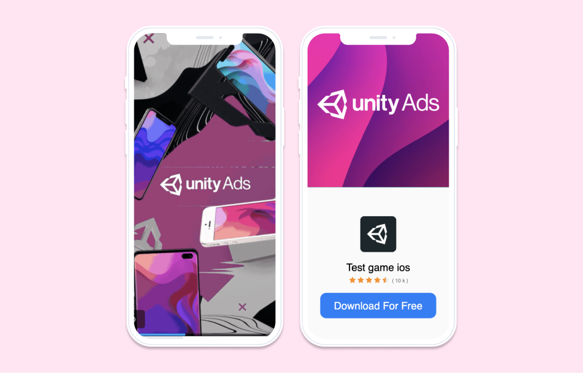
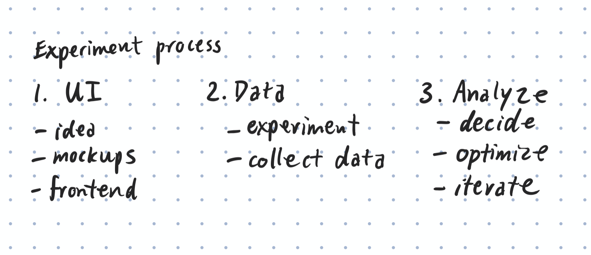
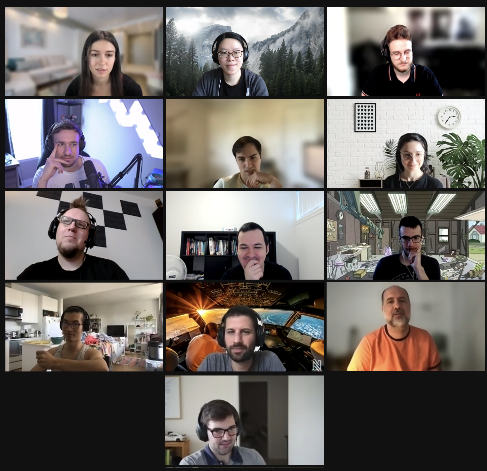

import { Link, graphql } from "gatsby"
import { Details, Blockquote } from "../components/details.js"
import {
  Accordion,
  AccordionItem,
  AccordionItemHeading,
  AccordionItemButton,
  AccordionItemPanel,
} from "react-accessible-accordion"
import MoreProjects from "../components/moreProjects.js"
import round from "../images/unity/round-button.png"
import blurred from "../images/unity/blurred-bg.png"
import glare from "../images/unity/glare-animation.gif"
import activate from "../images/unity/activate.gif"
import popbubble from "../images/unity/popbubble.gif"
import sliderblock from "../images/unity/sliderblock.gif"

  <h1 className="purple">{props.pageContext.frontmatter.shortTitle}</h1>
  <h2>{props.pageContext.frontmatter.title}</h2>

  <h3>
    My work during this internship is under an NDA, thus any data has been
    removed and this will be a high level recap of what I did and learned.
  </h3>

I joined the Ad Unit Innovation (AUI) team at Unity as a frontend engineering intern; our mission is to optimize the in-game advertisement experience for users and game publishers alike. During my internship, I helped to launch 7+ experiments which received close to a billion views overall and generated insights for my team to further iterate on advertisement designs.

#### What did I do?

 
 

As a frontend engineering intern, I worked on two main initiatives:

1. Creating new experiments to further optimize ads shown on the Unity Ad Network
2. Migrating legacy code to modern solutions and reusable components to make the code base lighter and a better experience for users

I learned a lot from both initiatives and was given the autonomy to work like a full-time employee with the team. I was one of 4 frontend engineers on a team of 12 with 3 backend and machine learning engineers, 2 data scientists, 1 full stack developer, 1 product designer and 1 product manager.

I also had the opportunity to participate in the internal Hackweek at Unity with a group of XR developers. Our project aimed to prototype two-handed interaction scripts that feel natural and can easily be implemented by developers using Unity's XR Interaction Toolkit.

## Experiments

Unity has an advertising network called Unity Ads. Developers can use the SDK that Unity provides to monetize their mobile games by showing ads at certain intervals. Ads typically are shown in a video and static format where a short demonstration of the advertised game is shown with a download button followed by a static image of the game and another download button that prompts users to download it.

My team works on optimizing the conversion of these ads by changing the layout and styling of elements controlled by Unity Ads such as the styling and animations on the download button, placement of images and UI, as well as the timing of when certain elements are shown. We also control what variation is shown to each user.

Experiments are variations done to the ad and shown on a small subset of traffic and increased to more audiences over time to determine if it improves overall conversion. To do this, my team uses a variety of machine learning and data analysis techniques to help optimize the process. One technique that we often referred to was the multi-armed bandit problem and its solutions. There's a great article by Liliam Weng about the concept <a href="https://lilianweng.github.io/lil-log/2018/01/23/the-multi-armed-bandit-problem-and-its-solutions.html" className="link" target="_blank" rel="noreferrer">here</a>.

 

  The overall process of creating an experiment on the Unity Ads network

Although I was technically a frontend engineer, I had the opportunity to work on all aspects of the experiment process. I helped to conceptualize ideas into mockups, implemented them in the frontend, created experiment templates, and analyzed the outcomes of the experiments. I learned a lot about the psychology of users and how they interact with advertisements, as well as data analysis and basic machine learning concepts.

<Accordion allowZeroExpanded>
  <AccordionItem>
    <AccordionItemHeading>
      <AccordionItemButton>
        Examples of experiments I worked on
      </AccordionItemButton>
    </AccordionItemHeading>
    <AccordionItemPanel>
      

  

    
    

      Round CTA button variant on endcard
    

  

  

    
    

      Blurred background variant on endcard
    

  

  Glare animation on CTA on video screen

  

    
    

      Bubble popping animation on the CTA on the video screen
    

  

  

   
    

      Scanner animation on the CTA on the video screen
    

  

  

   
    

      Activating animation on the CTA on the video screen
    

  

    </AccordionItemPanel>
  </AccordionItem>
</Accordion>

## Refactoring

The other initiative that I got to work on was refactoring old code into new, modern solutions with reusable components. Previously, we had multiple versions and files with the same button used in different locations, however, with this modernization effort, we were able to condense it down to a single component that is super customizable and reusable for all our use cases. I worked on migrating and refactoring many similar components throughout my internship.

To accomplish the feat, we used a CSS-in-JS solution called <a href="https://linaria.dev" className="link" target="_blank" rel="noreferrer">Linaria</a> that lets us style components easily and worked with our framework which was Preact. This allowed us to remove the SCSS files we were using previously. Also, because of this modernization, we were able to start using <a href="https://storybook.js.org" className="link" target="_blank" rel="noreferrer">Storybook</a>, a UI component explorer, which helps us build components in isolation and overall streamline our testing and documentation processes.

While this certainly was not as fun as creating new experiments, I learned a lot about building a reusable component library from the software side. It's super interesting to see how something like Material UI can be taken for granted now that I know how difficult it is to build something like it.

#### What did I learn?

## Don't get too attached to an idea

When working on experiments in the AUI team, it's surprising to see what sticks and what doesn't with users. While the team may think it will be a good change to make, the data may soon tell us otherwise. So even after putting in the effort to design and implement the idea, users may not like it and we end up scrapping the design, making our work go to "waste". However, without experimenting, we will never have known the true outcome and thus, it's important to keep iterating and trying new things!

## Ask for help and you can never be stuck

Coming into the internship, I thought I would be well prepared because I have previously used TypeScript, React, and CSS. However, I soon learned that there was a lot of things I didn't know about including the team's staging and deployment process, the mix between legacy code and new code, or even how the experiment process worked. I was initially scared of asking questions, but over time as my team encouraged me, I would ask questions all the time after trying to figure out the question on my own for around half an hour. Because of this policy I set for myself, I never truly ended up stuck and learned a lot along the way.

## Something simple can end up really complicated

Before working on the refactoring initiative, I originally thought it would be pretty simple. I mean making a button could be as simple as `<button>`Download`</button>` right? But I soon learned that it could take weeks just to make a simple component like that reusable and customizable for all circumstances. For another component I worked on that only had about 100 lines of code, I ended up getting around 70 comments on my pull request... 70! Thus, I learned the intricacies of creating common component libraries and to keep an open mind when things may seem simple at first.

#### Wrapping it up

 
 

Working at Unity was an absolute blast! While I never thought I would end up working on advertising, I learned a lot from the process including prototyping, data analysis, and best practices in software development. I'm proud of what I was able to achieve and I'm excited to continue my journey in software development and learn more about the gaming and graphics industry.

The entire AUI team!

Shoutout to my team AUI MAB for an awesome summer full of memes and learning! Everyone was super supportive and fun to work with. My mentor, Mikel, commented on my performance and said:

<Blockquote
  text={
    '"Emily has been an incredible help throughout her internship. She was able to release her first experiment faster than anyone has ever done before - interns and regular employees alike! She has released many front-end experiments over the course of her internship, some of which have been seen nearly a billion times by users all over the world! Over the last few months, Emily has grown and become a crucial member of our team. We could not have hoped for a better performance from a student."'
  }
/>
– Mikel Gascon, Mentor and Frontend Developer

 

#### More case studies

<MoreProjects
  projects={props.data.allMdx.edges}
  current={props.pageContext.frontmatter.order}
/>

export const pageQuery = graphql`
  query {
    allMdx(
      filter: { frontmatter: { company: { ne: null } } }
      sort: { order: ASC, fields: [frontmatter___order] }
    ) {
      edges {
        node {
          id
          frontmatter {
            title
            shortTitle
            path
            type
            order
            tags
            company
            thumbnail {
              childImageSharp {
                gatsbyImageData(
                  height: 280
                  placeholder: BLURRED
                  formats: [AUTO, WEBP]
                )
              }
            }
          }
        }
      }
    }
  }
`
